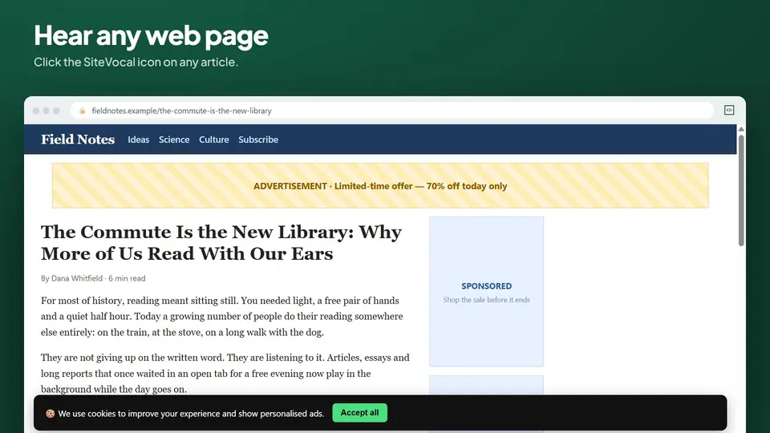
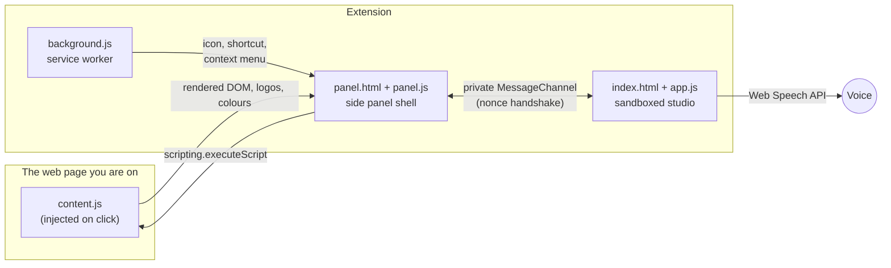

# SiteVocal

**Read any web page aloud, ad-free, or hear a short summary first.** SiteVocal is a free, open-source text-to-speech reader that runs as a Chrome extension (Manifest V3) and as a plain web app, from the same folder. No account, no API keys, no server.

[](LICENSE)
[](manifest.json)
[](#development)
[](#security-model)

[](media/sitevocal-demo.mp4)

▶ [Watch the 48-second demo with sound](media/sitevocal-demo.mp4) · 🌐 [Try the web app](https://hotragn.github.io/SiteVocal/) · 🔒 [Privacy policy](PRIVACY.md)

---

## Contents

- [What it does](#what-it-does)
- [Install](#install)
- [How it works](#how-it-works)
- [Privacy](#privacy)
- [Security model](#security-model)
- [Permissions](#permissions)
- [Development](#development)
- [Keyboard shortcuts](#keyboard-shortcuts)
- [Browser support](#browser-support)
- [Troubleshooting](#troubleshooting)
- [Contributing](#contributing)
- [License and credits](#license-and-credits)

## What it does

Click the SiteVocal icon on any page (or press `Alt+Shift+S`) and the side panel reads it with a live transcript. You choose how much to hear:

| Mode | What you hear |
|---|---|
| 📖 **Full Page Read** | Every word of the article, with ads, menus, cookie banners and sign-up boxes removed first |
| ✨ **Summarize Page** | What the page is, its strongest points, and its key table, usually in under a minute |
| ⚡ **Site Briefing** | What a company or website does in about a minute: who they are, what they offer, prices, and the top FAQs |

Also built in:

- **Follow along:** the sentence being spoken is highlighted. Tap any sentence to start there.
- **Section outline** with the listening time of each section.
- **Right-click menu:** *Start SiteVocal From Here*, *Speak Selection* and *Read linked page with SiteVocal*.
- **Library and Up Next:** every page resumes where you stopped, even offline.
- **Tables and pricing grids read as sentences** instead of cell by cell.
- **Speed** from 0.75× to 2×, a pronunciation dictionary, keyboard shortcuts and media keys.
- **Optional Turbo Engine:** bring your own Fish Audio or OpenAI-compatible key for studio voices or AI summaries. It's off by default.

## Install

### Chrome extension (from source)

1. Download this repository (**Code → Download ZIP**) and unzip it, or `git clone https://github.com/Hotragn/SiteVocal.git`.
2. Open `chrome://extensions` and turn on **Developer mode**.
3. Click **Load unpacked** and choose the folder that contains `manifest.json`.
4. Open an article and click the SiteVocal icon.

SiteVocal installs with no access to your websites. It reads a tab only when you click it there. *Allow all sites* is optional.

### Web app

Open **[hotragn.github.io/SiteVocal](https://hotragn.github.io/SiteVocal/)**, or double-click `index.html` in a downloaded copy. Paste a link or some text and press **Listen**. The web app reaches other sites through public page services (see [Privacy](#privacy)). The extension doesn't need them for the tab you're on.

## How it works



1. **`background.js`** turns the icon, `Alt+Shift+S` and the right-click items into a request and opens the side panel.
2. **`panel.js`** injects **`content.js`** into that one tab (`activeTab`). It returns the rendered page with hidden elements removed, plus logo candidates, brand colours and the paragraph you right-clicked.
3. The studio, **`index.html` + `app.js`**, runs as an MV3 *sandboxed page*, so it has no access to extension APIs. It talks to `panel.js` only over a private `MessageChannel`, set up with a per-instance nonce.
4. `app.js` parses the page in an inert `DOMParser` document with [Mozilla Readability](https://github.com/mozilla/readability). It then applies a 3-stage Ad-Shield, builds a spoken script for the chosen mode, and speaks it in chunks of about 10 seconds. That avoids Chrome's cut-off of long utterances at about 15 seconds.
5. Summaries use Chrome's on-device AI (Gemini Nano) when it's downloaded, and SiteVocal's own offline summarizer (TF-IDF and TextRank) otherwise.

The same `index.html` also runs on its own as the web app. Without the extension shell, it fetches pages itself.

## Privacy

SiteVocal collects nothing: there is no account, no analytics and no SiteVocal server. What you listen to is kept only in your browser, and **Your data** shows it and clears it. Data leaves your browser only in these cases, each shown in the app:

| When | What is sent | To whom |
|---|---|---|
| You use an **online voice**. Chrome's "Google" voices are online, and SiteVocal may pick one automatically for its natural sound | The text being read | The voice's provider, such as Google. The privacy shield turns amber and names it. On-device voices send nothing |
| You open a link SiteVocal can't load directly (in the extension, it asks you first) | The link's address | A public page service: allorigins.win, codetabs.com, corsproxy.io or r.jina.ai |
| You add your own **Turbo Engine** key | The text to speak or summarize | Only the service you chose |

The full policy, with storage keys, timings and permissions, is in **[PRIVACY.md](PRIVACY.md)**.

## Security model

- **No remote code.** Every script ships in the package. Extension pages and the sandbox run under `script-src 'self'`, with no `eval`, no `new Function` and no inline scripts. Fonts are bundled too, so the studio contacts no CDN.
- **Untrusted pages stay inert.** Page HTML is parsed in a `DOMParser` document, and only escaped text is rendered.
- **Least privilege.** There are no host permissions at install. `http(s)://*/*` is optional, requested only from a click, and can be removed at any time.
- **Narrow bridge.** The sandboxed studio can only ask `panel.js` for a fixed set of actions. Storage keys must start with `sitevocal`, and Turbo requests may go only to the endpoints saved with a key. Image fetches never include cookies or go to private-network addresses.

## Permissions

| Permission | Why |
|---|---|
| `activeTab`, `scripting` | Read the tab you clicked SiteVocal on, with the packaged `content.js` |
| `sidePanel` | Keep playing in the side panel while you browse |
| `contextMenus` | *Read this page*, *Start SiteVocal From Here*, *Speak Selection*, *Read linked page* |
| `storage` | Pass the icon or menu request to the panel, and remember side-panel or popup mode |
| `optional_host_permissions` | Only if you press **Allow all sites**: read other tabs, load links directly, and support the right-click helper |

## Development

There is no build step: the files in this repository are the extension.

```text
├── manifest.json            Manifest V3: side panel, sandbox, commands, CSP
├── background.js            Service worker: icon, shortcut, context menus, popup/side-panel mode
├── panel.html, panel.js     Extension shell: hosts the studio, bridges tab access, fetch, storage, on-device AI
├── content.js               Injected into the tab being read: rendered DOM, logos, colours, SPA watcher
├── context-hook.js          Remembers the right-clicked element (only with all sites allowed)
├── index.html, app.js       The studio: extraction, Ad-Shield, modes, speech engine, UI
├── vendor/                  Readability 0.6.0, compiled Tailwind CSS 4.3.3, bundled fonts (see vendor/README.md)
├── icons/                   16–512 px
├── PRIVACY.md               Privacy policy
├── CHROME_STORE_LISTING.md  Store texts, permission justifications, compliance notes
├── store-assets/            Store screenshots and promo tiles, and the rig that captures them (shots/)
└── media/                   Demo video and its README preview
```

**Run it**

- *Extension:* load the folder unpacked (see [Install](#install)). After editing, click **Reload** on the SiteVocal card in `chrome://extensions`, and reopen the side panel.
- *Web app:* serve the folder and open it:

  ```sh
  python -m http.server 8765
  ```

  Then open `http://127.0.0.1:8765/`.

**Rebuild the styles** after changing Tailwind classes. See [vendor/README.md](vendor/README.md).

**Package for the Chrome Web Store.** This works on macOS, Linux and Windows 10 or later. Bump `version` in `manifest.json` first:

```sh
mkdir dist
tar -a -c -f dist/sitevocal-chrome-store.zip manifest.json background.js content.js context-hook.js panel.html panel.js index.html app.js vendor/readability.min.js vendor/styles.css vendor/fonts.css vendor/fonts icons LICENSE THIRD_PARTY_NOTICES.txt
```

The listing texts and dashboard answers are in [CHROME_STORE_LISTING.md](CHROME_STORE_LISTING.md).

**Regenerate the store screenshots and demo video.** [`store-assets/shots/frame.html`](store-assets/shots/frame.html) hosts the real studio as a side panel next to a sample page, over the same protocol as `panel.js`. With the folder served on port 8765:

```sh
node store-assets/shots/record-demo.mjs ./recording
python store-assets/shots/make-demo.py ./recording media/sitevocal-demo.mp4 media/sitevocal-demo.webp
```

`record-demo.mjs` needs Node 22+ and Chrome. `make-demo.py` needs Windows (for the narration voice), Pillow, NumPy and PyAV.

## Keyboard shortcuts

| Keys | Action |
|---|---|
| `Space` / `K` | Play / pause |
| `J` / `L` | Previous / next sentence |
| `←` / `→` | Previous / next paragraph (`Shift` = sentence) |
| `B` | Clip the spoken sentence with its source |
| `[` / `]` | Slower / faster |
| `1` / `2` / `3` | Reader · Library · Docs & Lexicon |
| `S` | Toggle the Saved Library sidebar |
| `F` | Follow the current paragraph |
| `/` | Focus the address field |
| `?` / `Esc` | Shortcuts / close panels |
| `Alt` + `Shift` + `S` | (Extension) read the current tab |

## Browser support

| Browser | Web app | Extension |
|---|---|---|
| Google Chrome / Chromium 116+ | ✅ | ✅ side panel |
| Microsoft Edge | ✅ | ✅ side panel |
| Other Chromium browsers (Brave, Vivaldi, Opera…) | ✅ | ✅ side panel where supported, otherwise a popup |
| Safari 16.4+ | ✅ | — |
| Firefox | ✅ | — |

Speech needs at least one installed voice. On Linux, install `speech-dispatcher`. Chrome's on-device summarizer needs Chrome 138+ on supported hardware; elsewhere, the built-in summarizer is used.

## Troubleshooting

- **The extension can't read a tab.** Browser pages (`chrome://…`, the Web Store, the new tab page) and PDFs can't be read by extensions. For local files, turn on *Allow access to file URLs* on the SiteVocal card in `chrome://extensions`.
- **"SiteVocal can't see this tab yet."** Click the SiteVocal icon while you're on that tab, or press **Allow all sites** once.
- **"Couldn't read this page"** (pasted link). The site blocks public page services. Open it in a tab and click the SiteVocal icon there, or paste the text instead.
- **Something real was skipped.** Turn off **Skip Code**, **Skip Tables** or **Skip Citations** in the filter bar.
- **A word is mispronounced.** Add it under *Docs & Lexicon › Pronunciation dictionary*.
- **No sound.** Check that your operating system has text-to-speech voices installed.

## Contributing

Bug reports and pull requests are welcome. **[Open an issue](https://github.com/Hotragn/SiteVocal/issues)** with the page address (if it's public), your browser and version, and what you expected to hear. For a page that reads badly, a screenshot of the side panel helps most.

## License and credits

SiteVocal is licensed under the [Apache License 2.0](LICENSE). It bundles:

- [Mozilla Readability](https://github.com/mozilla/readability) 0.6.0 (Apache 2.0)
- [Tailwind CSS](https://tailwindcss.com) 4.3.3, compiled (MIT)
- [Lucide](https://lucide.dev) icons (ISC)
- Plus Jakarta Sans, Newsreader and JetBrains Mono fonts (SIL Open Font License 1.1)

Full license texts are in [THIRD_PARTY_NOTICES.txt](THIRD_PARTY_NOTICES.txt).
