# SiteVocal — Free Zero-API Website to Speech & Ad-Free Audio Reader

[](LICENSE)
[](#privacy-and-security)
[](https://developer.mozilla.org/docs/Web/API/Web_Speech_API)
[](#2-use-it-as-a-chrome-extension)
[](#quick-start)

**SiteVocal is a free, open-source website-to-speech reader that reads you a short summary of any page's key points, tells you what any company or website does in about a minute, or strips the ads and clutter out of any article and reads every word like a radio broadcast, using the Web Speech API already built into your browser: no API keys, no accounts, no servers and no build step.** Paste a URL (or click the Chrome extension on any tab). A company homepage, a pricing or about page opens as a **⚡ Site Briefing**: the company's logo and brand colour, then a spoken 4-part dossier of who they are, what they provide, pricing and audience, and their key FAQ. An article opens as **📖 Full Page Read**: a 3-stage Ad-Shield removes ad slots and clutter before Mozilla Readability extracts it, and SiteVocal reads it with the most natural voice on your device, on a live teleprompter with a section outline. **✨ Summarize Page** gives you the short version instead: one line on what the page is, its three to five strongest points from anywhere on the page, and one plain sentence for its pricing or main table, usually in under a minute. One click switches between the three on any page; clip quotes with their source, queue what you want to hear next, and pick up exactly where you stopped.

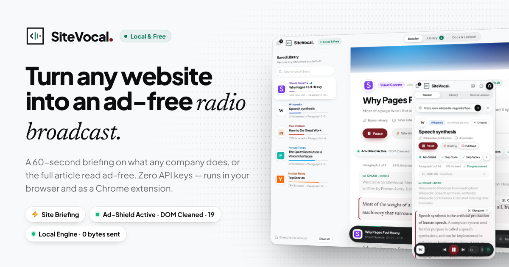

- **Three ways to listen:** **✨ Summarize Page** reads the whole page in a few minutes, section by section, tables and lists included. **⚡ Site Briefing** detects homepages, `/pricing` and `/about` pages and marketing landing pages and briefs them in 60–90 seconds. **📖 Full Page Read** reads every word of an article. All three are deterministic and local by default: they read JSON-LD, meta tags and the page's own sections and tables, and never a menu, cookie banner or "Sign up" button.
- **Any link, ready before you ask:** a link starts loading the moment you paste it, so Listen usually opens it from memory. GitHub repositories (with their full README), files, issues and discussions come from GitHub's own API, and still open past its hourly limit. JavaScript-built SaaS sites are rendered by the keyless `r.jina.ai` reader, which is asked only for pages that need it. In the extension, a page you already have open is read straight from its tab.
- **Zero setup, zero remote code:** double-click [`index.html`](index.html) and it works. Every script is a local file: `app.js`, plus Mozilla Readability and the compiled Tailwind CSS in [`vendor/`](vendor/). The page runs offline and under Chrome's strictest extension policy, `script-src 'self'`.
- **The same folder is a Chrome extension:** load it at `chrome://extensions` → *Load unpacked*, then click the icon on any article, or right-click → **Start SiteVocal From Here**. It installs with no access to your websites and reads only the tab you click it on; **Allow all sites** is optional.
- **Collects nothing:** no account, no analytics, no tracking and no SiteVocal server. Your library stays in your browser, and **Your data** shows it, clears it in two taps, or forgets it every time you close SiteVocal.
- **Honest about privacy:** the dock's privacy shield is green — *Local Engine · 0 bytes sent to the cloud* — when your voice runs on-device, and turns amber, naming the vendor, when an online voice is in use. The optional **Turbo Engine** (your own Fish Audio or OpenAI-compatible key) sends nothing until you paste a key.
- **Ready for the Chrome Web Store:** the listing texts, single-purpose statement and permission justifications are in [`CHROME_STORE_LISTING.md`](CHROME_STORE_LISTING.md), and the privacy policy is [`PRIVACY.md`](PRIVACY.md).

---

## Contents

- [Quick start](#quick-start)
- [What's new in 2.6: your data, your call](#whats-new-in-26-your-data-your-call)
- [What's new in 2.5: links that are ready before you ask](#whats-new-in-25-links-that-are-ready-before-you-ask)
- [What's new in 2.4: open any link](#whats-new-in-24-open-any-link)
- [What's new in 2.3: Summarize Page](#whats-new-in-23-summarize-page)
- [What's new in 2.2: Site Briefing](#whats-new-in-22-site-briefing)
- [What's new in 2.1](#whats-new-in-21)
- [What's new in 2.0](#whats-new-in-20)
- [Features](#features)
- [Screenshots](#screenshots)
- [How SiteVocal works](#how-sitevocal-works)
- [Site Briefing mode](#site-briefing-mode)
- [Summarize Page mode](#summarize-page-mode)
- [The 3-stage Ad-Shield](#the-3-stage-ad-shield)
- [Filter chips and the Smart Lexicon](#filter-chips-and-the-smart-lexicon)
- [The Chrome 15-second speech cut-off — and how SiteVocal fixes it](#the-chrome-15-second-speech-cut-off--and-how-sitevocal-fixes-it)
- [Smart Broadcast Script Synthesizer](#smart-broadcast-script-synthesizer)
- [Design system](#design-system)
- [Saved Library, Up Next and clipped quotes](#saved-library-up-next-and-clipped-quotes)
- [Voice selection](#voice-selection)
- [Optional Turbo Engine](#optional-turbo-engine)
- [Keyboard shortcuts](#keyboard-shortcuts)
- [Privacy and security](#privacy-and-security)
- [Publishing to the Chrome Web Store](#publishing-to-the-chrome-web-store)
- [Tested on real-world pages](#tested-on-real-world-pages)
- [Browser support](#browser-support)
- [Project structure](#project-structure)
- [Customising SiteVocal](#customising-sitevocal)
- [Troubleshooting](#troubleshooting)
- [FAQ](#faq)
- [Credits and licence](#credits-and-licence)

## Quick start

### 1. Use it as a web app (zero setup)

1. Download or clone [this repository](https://github.com/Hotragn/sitevocal): `git clone https://github.com/Hotragn/sitevocal`, or **Code → Download ZIP** and unzip it.
2. **Double-click `index.html`**.
3. Paste any website or article URL into the command bar — or click a **Quick Try** pill (Wikipedia, Paul Graham Essays, Hacker News, **Company Homepage**) — and press **Listen**. A homepage plays a ⚡ Site Briefing, an article a 📖 Full Page Read; one click in the reader switches to the other, or to ✨ Summarize Page.

No `npm install`, no bundler, no server. You can also host the folder on any static host (GitHub Pages, Netlify, Cloudflare Pages) and share links such as `index.html?url=https://en.wikipedia.org/wiki/Speech_synthesis`.

### 2. Use it as a Chrome extension

1. Open `chrome://extensions` (or `edge://extensions`, `brave://extensions`).
2. Turn on **Developer mode**.
3. Click **Load unpacked** and choose the **same folder** (the one that contains `manifest.json`).
4. Pin **SiteVocal**, open any article and click the icon — or press **Alt+Shift+S**.

The side panel opens, reads the active tab's live DOM (including pages you are signed in to), picks up the site's logo and colours, and starts playing — a Site Briefing on a company homepage, the full text on an article. SiteVocal installs with **no access to your websites**: clicking the icon, the shortcut or a right-click item lets it read that one tab (Chrome's `activeTab`). Switch to another tab and the side panel says it can't see it yet: click the icon there, or press **Allow all sites** once (Chrome asks you first) so the side panel follows every tab, and links you paste load straight from your browser. **Re-read tab** in the reader's toolbar reads the tab again after it changes. With all sites allowed, opening the side panel any other way reads the page you are on too, and a link you paste that is already open in a tab is read from that tab. Right-click a paragraph for **Start SiteVocal From Here**, a selection for **Speak Selection**, or a link for **Read linked page with SiteVocal**. Single-page apps and infinite scroll are watched: when the page changes, a **Page changed · Re-sync** pill appears in the filter bar and your audio keeps playing until you click it. Right-click the toolbar icon to open the studio in a full tab, or to make the icon open a popup instead of the side panel.

### 3. Publish it on GitHub Pages

*Settings → Pages → Build and deployment → Deploy from a branch → `main` / root.* The studio is then live at `https://hotragn.github.io/sitevocal/` — the canonical URL already used by the page's SEO tags.

## What's new in 2.8: the page goes to a model, which cleans it and summarizes it

| Area | Change |
|---|---|
| Model first | ✨ Summarize Page gives the whole cleaned page to a model, told to ignore menus, buttons, the name of whoever posted it, follower and like counts, captions, ads and lists of technologies, and to answer with a one-line overview and 3 to 5 key points (as JSON, checked against a schema). The model is your Turbo LLM when you set a key, else your browser's own on-device model (Chrome's Gemini Nano through the Prompt API; Chrome's Summarizer API when only that exists). SiteVocal's offline summary plays only when there is no model, or it fails. |
| Browsers | Detected, never assumed: Chrome has the on-device model today. Edge's is a developer preview (Canary and Dev), and Brave and Safari offer none to web pages or extensions yet; they get the offline summary and pick up a model automatically when they ship one. |
| One-click download | When your browser can download its model, the summary offers it once (*"download your browser's free on-device AI"*), also from the side panel. Nothing is downloaded without that click. |
| Social posts | Titles like *"(1) Ada Lovelace on X: "…" / X"* become the post's own title; the poster's name and the notification count are not read. *"In short"* is no longer spoken, the title is never repeated as a point, and a half sentence ("just announced…") is never picked. |

## What's new in 2.7: a summary is a summary

Tested on the pages people reported: a GitHub profile README and a Wix domain search.

| Area | Change |
|---|---|
| Summarize Page | A real summary: one line on what the page is, then its three to five strongest points from anywhere on the page, in page order, and at most one table line. Section headings are no longer read out, there is no card per section and no *"Also covered"* line. A long GitHub profile went from almost 5 minutes to under a minute. |
| No jargon | A point that is mostly code, versions, acronyms and numbers (*"Next.js 15 three.js NASA GIBS…"*) is never picked, and neither is a line about the layout (*"every number below…"*). |
| One plain table line | The page's pricing table, else its biggest table of numbers, becomes one sentence: *"In the Benchmarks table, Vertex Pro has the highest Score (9,120) and Quill 13 the lowest (6,300)."* Text tables (skills, links) stay on screen in Full Page Read. |
| On-device AI and Turbo | Chrome's Summarizer and a Turbo LLM are asked once for the whole page (an overview and 3 to 5 key points), not once per section. |
| Captions | A caption under an image (`<sub>` or `<small>` text, as in GitHub READMEs) is never read: it was being spoken as if it described the page's subject. |
| Tags and link rows | A row of tech tags at the start of a paragraph (`Neo4j` `LangChain` …) is its own short line in Full Page Read and is never summarized. Rows of links (*"Live demo · Repo"*, *"Portfolio · Resume · GitHub"*, *"All posts →"*) are not read. |
| Repeats | A scrolling banner's copies (*"Trusted by 300+ million"* four times) are heard once. |
| Cards and prices | A result or product card is one line (*"Best Match, site-vocal.com, $0.00 a year (was $7.90 a year), Free for 1 year"*). A struck-out price is read as *"was"*, prices per period are spoken *"a year"* / *"a month"*, words in neighbouring elements no longer run together ("yrFree"), and *Back* / *Show more* buttons are not read. |
| Page or article | Only a page that reads like an article is signed off as *"this article"*; a list of results is *"this page"*. A summary ends *"That's the summary of [site]."* |
| GitHub profiles | Named after the person, with their bio as the overview, instead of *"Hotragn - Overview"* and *"has 145 repositories available. Follow their code on GitHub."* A profile is briefed as a page about someone, not as a company. |

## What's new in 2.6: your data, your call

SiteVocal collects nothing, and now says so where you can see it. The extension asks for nothing at install, and your listening history is one click from gone.

| Area | Change |
|---|---|
| Collects nothing | The start page, the privacy panel and the new **Your data** dialog say it plainly: *SiteVocal collects nothing: no account, no analytics, no tracking.* There is no SiteVocal server to send anything to. [`PRIVACY.md`](PRIVACY.md) and the store listing say the same. |
| Your data | Opens from the start page, the Library's footer (*Stored in this browser*) or the privacy panel. It lists what SiteVocal keeps in this browser (saved sites and pages, clips, Up Next, your own dictionary words, settings, Turbo keys) and how much space it takes. It also says which services can see a page's address or text, and in the extension it shows your site access. |
| Clear everything | Two taps delete every `sitevocal_*` key, and in the extension the pending toolbar request and the icon's popup setting too. Other data of the website that hosts SiteVocal is never touched. SiteVocal then restarts empty. |
| Forget on close | *Forget what I listened to when I close SiteVocal* erases your library, saved pages, clips, Up Next and statistics each time you close SiteVocal: the tab, or the side panel, popup or SiteVocal tab. Settings, your dictionary and keys stay. Switching tabs never erases anything. Browsers do not let a page ask a question as it closes, so this is the switch you set ahead of time. |
| A one-time note | After your first listen, *Continue listening* says once that everything is saved only in this browser, with **Your data** and **Got it**. |
| Optional site access | The extension no longer asks for access to every site at install: `host_permissions` and the static content script are gone, and `http://*/*` and `https://*/*` are `optional_host_permissions`. Clicking SiteVocal on a tab reads it (`activeTab`). **Allow all sites**, in the tab card, the error card, the privacy panel or *Your data*, shows Chrome's prompt. With access, the side panel follows every tab, pasted links load straight from your browser with your sign-ins, and the right-click helper is registered. Without it, a pasted link loads the way the website version loads it, once you agree (below). *Site access · Remove* takes it back. |
| Turbo, one service at a time | In the extension, **Test voice** asks Chrome for only the voice service you chose (for example `https://api.fish.audio/*`). A Turbo call that Chrome blocks offers **Allow** for that one service. |
| Asked first: page services | Without site access, the extension asks once in the loading card before a public page service (allorigins.win, codetabs.com, corsproxy.io or r.jina.ai) may fetch a link: *Open links this way*, *Allow all sites instead* or *Not now*, which sends nothing. **Allow all sites** first explains what changes, then Chrome asks. Nothing is loaded ahead on hover, and no domain goes to Google's favicon service. *Your data* shows the answer and **Ask again** takes it back. |
| HTTPS only | A Turbo endpoint must be `https://`. Plain `http://` works only for a server on your own computer or network; any other one is saved but never used, and the form says so. |
| Chrome Web Store compliance | Checked with open-source tools on the exact store package: [webstore-lint](https://github.com/Circadian-agent/chrome-extension-rejection-lint) (no findings, every permission used), Chromium (no permission warning at install), Mozilla's addons-linter and no-unsanitized rule (every HTML template reviewed), retire.js (no vulnerable libraries) and the SchemaStore manifest schema. The 440 × 280 small promo tile (required) and a 1400 × 560 marquee tile are in [`store-assets/`](store-assets/). Results and the policy-by-policy table: [`CHROME_STORE_LISTING.md`](CHROME_STORE_LISTING.md#5-compliance-check-21-october-2026-version-280). |

## What's new in 2.5: links that are ready before you ask

Listen now usually finds the page already loaded. The page reader's free quota goes only to the pages that need it, and GitHub threads open even past GitHub's hourly API limit.

| Area | Change |
|---|---|
| Predictive prefetch | A link starts loading the moment you paste it into the start page or the address pill, or when you stop typing a full address for 250 ms. Resting the pointer for 120 ms on a Quick Try, Up Next or Library item does the same. When you press Listen, SiteVocal takes the finished page from memory (a few milliseconds), or joins the load still on its way. Nothing is fetched twice. The cache lives in memory only: at most 10 pages, 5 minutes each. A quick pass of the pointer, a click or a tap is not a hover. |
| Two-tier race | The direct fetch and both `api.allorigins.win` endpoints start at once. The `r.jina.ai` reader joins only when they cannot do the job: one returns an empty app shell (it joins at once), all of them fail, or nothing readable has come back within 220 ms. A server-rendered page that arrives first never reaches the reader. Its address stays private, and the reader's 20 free pages a minute are kept for JavaScript-built sites. `api.codetabs.com` still joins at 350 ms and `corsproxy.io` at 2.5 s. |
| TinyFish alone | With a TinyFish key, TinyFish renders the page in place of the keyless reader. Keyless `r.jina.ai` steps in only if TinyFish fails. |
| GitHub past the limit | When `api.github.com` refuses (403 or 429 after 60 requests an hour), a README is read from `raw.githubusercontent.com`: on the default branch (`HEAD`), then `main`, then `master`. Issues, pull requests and discussions are read from the page itself instead. Discussions, which the REST API does not serve, are always read that way. GitHub's own HTML is used when it carries the thread. Newer GitHub pages are built with JavaScript, so `r.jina.ai`'s rendering is used otherwise. Either way GitHub's menus, repository tabs, sign-in prompts, sidebar and footer are cut. The intro says the state, author and labels, and each comment is read as *"grace-h writes: …"*. |
| Extension, one hop | With site access (optional since 2.6), a pasted address that is not open in a tab is fetched with the extension's permissions first. When that returns an empty app shell, the extension goes straight to the page reader, with no public proxy in between: they would only return the same shell. |
| Gapless sentences | While one sentence is spoken, the next one's utterance is already prepared. At the end of a sentence the next is handed to the speech engine before the highlight and the saved place are updated. The hand-over takes well under a millisecond. |

## What's new in 2.4: open any link

Paste a GitHub repository, a JavaScript-built SaaS homepage or a page you already have open, and it plays at once. No keys needed.

| Area | Change |
|---|---|
| GitHub links | Repositories, files (`blob/…` and `raw.githubusercontent.com`), issues and pull requests are read through GitHub's own REST API, which accepts requests from any web page. For a repository, the repository and its rendered README are fetched in parallel. The owner's avatar becomes the logo, and the name, description, stars, forks, language, licence, topics and website open the page. Then the whole README is read, with its tables summarized in ✨ Summarize Page and Site Briefing. Badges, link rows and code blocks are shown but not spoken. Past the API's limit of 60 requests an hour, the README comes from `raw.githubusercontent.com`. |
| Every route at once | A pasted URL no longer tries one proxy after another. These requests start together: a direct fetch, `api.allorigins.win` (its raw and its JSON endpoint) and the keyless reader [`r.jina.ai`](https://jina.ai/reader). `api.codetabs.com` joins after 350 ms. `corsproxy.io`, which now often answers 401, joins after 2.5 s, or sooner once every other route has failed. The first route that returns a real page wins, and the other requests are cancelled at once. |
| JavaScript-built sites | Next.js, React and other single-page apps send an empty shell to every raw-HTML route. SiteVocal recognises a shell (fewer than 200 readable characters) and waits for r.jina.ai, which renders the page before it reads it. Its Markdown is turned back into a page: headings, paragraphs, lists and `\|---\|` tables. The briefing, the summary and the pricing tables then work as on any other site. |
| Open tabs first (extension) | You may paste a link in the side panel that is already open in a tab. SiteVocal reads it live from that tab, with nothing downloaded; `www.`, `#` anchors and `utm_` tags don't stop the match. The side panel also reads the page you are on as soon as it opens, even when Chrome drops the toolbar click. A new **Re-read tab** button in the reader's toolbar reads the tab again. |
| Feels instant | While a page loads, the address pill shows its stage: *Connecting*, then *Extracting DOM*, then *Ready · 412 ms*. A spinner replaces the → button meanwhile. The first word is spoken in the same task that draws the page. The other two listening modes are prepared while the browser is idle, so switching speaks within Chrome's 80 ms settle after it stops a voice. The first page after start-up no longer pays the browser's one-time compile costs either: SiteVocal warms up on a tiny built-in page while it waits for you. |
| Optional reader keys | *Docs & Lexicon › Turbo Engine › Page reader* takes your own **Jina** or **TinyFish** key, for more than the 20 pages a minute r.jina.ai allows without one. Keyless stays the default. |

## What's new in 2.3: Summarize Page

Hear the whole page, not just its first paragraph, and every table on it.

| Area | Change |
|---|---|
| ✨ Summarize Page | A third segment in the reader's mode bar: **⚡ Site Briefing · 📖 Full Page Read · ✨ Summarize Page**. After the 3-stage Ad-Shield, SiteVocal splits the page at its `H1` and every `H2`/`H3`. It scores each sentence by position, TF-IDF and TextRank keyword centrality, and how many numbers and names it carries, then keeps the best of every section within a budget that grows with the page: about 2 minutes for a 20-minute article, about 3 for the longest pages. Each section becomes a card on a summary sheet, and the dock and library say *Page Summary*. |
| Tables, grids and lists | In Summarize Page and Site Briefing, `<table>`s, pricing and comparison grids, `<dl>` spec lists and `<ul>`/`<ol>` lists are never skipped, even with **Skip Tables** on. They are spoken as sentences: *"Table Summary for Plans compared: Compares 3 items across Price, Storage and Seats. Key highlights: Starter has Price: $0, Storage: 5 GB, Seats: 1; …"*. Numeric columns also get their highest and lowest values, unit-aware (1 TB beats 100 GB). Each one appears in the teleprompter as a **Summarized Table Card**. Promotional "Add to cart" boxes, layout tables and calendars are left out. |
| On-device AI | When Chrome's built-in **Summarizer** (Gemini Nano) is already downloaded, Summarize Page asks it for each section's key points, on your device. If it is not downloaded, fails or takes longer than 30 seconds, SiteVocal's own summarizer plays instantly. SiteVocal never starts the model download by itself. |
| Turbo Engine (optional) | Paste your own **Fish Audio** key, or any **OpenAI-compatible** speech or chat endpoint and key, in *Docs & Lexicon › Turbo Engine*, for a neural voice or an LLM-written summary. With no key saved, nothing is sent: *0 Bytes Sent to Cloud*. With a key, only that endpoint receives the text, without cookies, and the privacy panel names it and counts the bytes. |
| Chrome Web Store ready | No remote code. Mozilla Readability 0.6.0 and the compiled Tailwind CSS 4.3.3 ship in [`vendor/`](vendor/), all JavaScript is in `app.js` with no inline scripts or handlers, and the sandbox CSP is `script-src 'self'`. [`CHROME_STORE_LISTING.md`](CHROME_STORE_LISTING.md) has the listing texts, single-purpose statement and permission justifications, and [`PRIVACY.md`](PRIVACY.md) is the privacy policy. |
| Fixes | The article overview in Site Briefing no longer reads image captions, reader call-outs ("Share your photos…"), datelines or duplicate lines, never ends on a dangling colon, and drops the site name repeated at the end of a title. The summary and briefing sheets fit a 400 px side panel: a wide table scrolls inside its card. |

## What's new in 2.2: Site Briefing

Paste a company homepage — or click the extension on one — and hear what the company does before you scroll past a single hero banner.

| Area | Change |
|---|---|
| Site Briefing mode | A deterministic, zero-API **4-part dossier** read from the raw page before the Ad-Shield and Readability strip it: **01 · What They Do** (JSON-LD `Organization` / `WebSite` / `SoftwareApplication` / `Product` / `LocalBusiness`, the meta and Open Graph descriptions, the hero `<h1>` and lead paragraph), **02 · What They Provide** (3–6 feature cards, sections or feature-list items), **03 · Pricing & Audience** (plan cards, free tiers, trials, open source, menu prices, "Built for …"), **04 · Key Takeaways** (JSON-LD `FAQPage` and on-page FAQs, otherwise section takeaways). Spoken in 60–90 seconds; parts with nothing on the page are left out. |
| Mode switch | A segmented **⚡ Site Briefing (What They Do) · 📖 Full Page Read** pill beside *Listen* on every page. One click switches and keeps playing; each mode keeps its own place, and the library remembers your choice per page. On an article the briefing is a 45-second overview: site, description and each section's first sentence. |
| Auto-detection | Root homepages (also `/en`, `/en-gb` and GitHub-Pages project roots), `/pricing` and `/about` pages, and marketing landing pages (cards, calls to action, company JSON-LD, short scattered paragraphs) open as a briefing; articles (`NewsArticle` JSON-LD, `og:type=article`, long narrative text) open as a full read. |
| Dossier sheet | The teleprompter becomes a company / website dossier: logo, site name, domain and a brand-colour swatch at the top, then four numbered cards that glow in the site's own colour while they are spoken, with plan and fact chips. |
| No CTA noise | Menus, page headers and footers, forms, buttons, cookie and announcement banners, testimonials, logo walls and lines like "Sign up", "Log in", "Book a demo", "Start free trial", "Learn more" or "Contact sales" are never shown or spoken. |
| Start page | New hero line — *Paste any website or article URL — hear an instant 60-second briefing on what a company does, or listen to full articles ad-free* — and a **Company Homepage** Quick Try pill: SiteVocal's own product homepage, fetched live when online and read from a built-in snapshot when offline. |

## What's new in 2.1

A flagship polish pass: the same features, rebuilt to feel like a product rather than a prototype.

| Area | Change |
|---|---|
| Brand | A mixed-case **SiteVocal** wordmark in Plus Jakarta Sans ExtraBold (tight −0.035em tracking, one ink colour and a burgundy full stop that repeats the logo's point) next to the straight-line Speaking Tag and a green-dot **Local & Free** badge. |
| Start page | One command bar (the address pill only appears once a page is open), **Quick Try** demos, and a sound-ripple field behind the hero: rows of faint dots that resolve into emerald letters as each ripple passes. Below it, a **What users reported** switchboard: six common complaints about free read-aloud tools, each next to the raw text other readers speak and the cleaned line SiteVocal speaks, with a one-click spoken preview. |
| Reader | A white reading sheet on the `#F8F9FA` canvas: a website identity header (cover, logo, site-name pill, 36 px title, author, listening time), a translucent liquid-glass filter bar *below* it that never overlaps the title, 20 px Newsreader in a 66ch column, and a borderless burgundy-ruled card for the paragraph being spoken — no underlines. In the side panel and on phones the header turns compact once listening starts, so the spoken intro sits above the dock. |
| Player | A floating obsidian-glass pill dock (max 760 px, 20 px above the bottom): logo and title on the left, a burgundy Play with previous / next in the centre, an emerald waveform and speed / voice pills on the right, and a progress rim you can scrub. Every view keeps 140 px of runway under its last card, so nothing stays hidden behind the dock. |
| Layout | Borderless Saved Library sidebar and Section Outline rail; an Apple-style segmented **Reader · Library · Docs & Lexicon** control; a clean **Star on GitHub** pill; the grey status strip is now a privacy panel that opens from the dock. |
| Copy & motion | Human microcopy everywhere — no bracketed or underscored telemetry strings. A sliding tab thumb, rising panels and a spring-in dock, all honouring `prefers-reduced-motion`. |
| Real-world fixes | Right-to-left articles, bylines in other languages, journalist-over-publisher bylines and link-shortener redirects, found by [testing on pages SiteVocal was never developed on](#tested-on-real-world-pages). |
| Final polish | Plus Jakarta Sans at full size in the extension side panel (Chromium's injected extension font rule no longer wins); a calmer follow-scroll that keeps the website header on screen when the first paragraph starts; no "!, written by" in the spoken intro; one pair of quotation marks on clipped quotes; a scrolling chip strip with a cue instead of cut-off labels; no hyperlink-blue accents from unstyled pages (SiteVocal emerald instead); library cards in step with the reader during the intro; and an offline fallback that keeps icons icon-sized when the Tailwind CDN is unreachable. |

## What's new in 2.0

| Area | Change |
|---|---|
| Ad-Shield | Ads, sponsored blocks, Taboola/Outbrain grids, "Read more:" boxes, affiliate disclaimers and newsletter sign-ups are stripped *before* parsing, and counted per page (*DOM Cleaned · X*). |
| Listening | Section Outline with per-section time, click-any-sentence start, **Clip Quote** (`B`), an **Up Next** queue that auto-plays, sentence-level media keys. |
| Speech | Sanitizer pills to skip or read code, tables and citations; a **Smart Lexicon** with an editable pronunciation dictionary. |
| Extension | **Start SiteVocal From Here**, **Speak Selection**, and a SPA / infinite-scroll watcher with a non-destructive re-sync. |

## Features

| Feature | What it does |
|---|---|
| **✨ Summarize Page** | The whole page in a few minutes: the most informative sentences of every `H2`/`H3` section (position, TF-IDF, TextRank, numbers and names), with tables, `<dl>` spec lists and bullet lists summarized as sentences on Summarized Table Cards. Written by Chrome's on-device Summarizer when it is downloaded, by SiteVocal's offline summarizer otherwise. |
| **Site Briefing mode** | A 60–90 second spoken dossier of any company homepage, pricing or about page — who they are, what they provide, pricing and audience, key FAQ — read from JSON-LD, meta tags and the page's own cards and sections, with zero calls-to-action read aloud. Auto-detected, or one click away on any page. |
| **3-stage Ad-Shield** | Stage 1 removes ad slots by selector and by class/id tokens matched on word boundaries; stage 2 removes link boxes, affiliate disclaimers and newsletter sign-ups; stage 3 reports the count in the filter bar (*Ad-Shield Active · DOM Cleaned · X*) and the lifetime total in the privacy panel. |
| **Pasted URL mode** | A two-tier race. The direct fetch and `api.allorigins.win` start at once. The keyless `r.jina.ai` reader joins only for an app shell, after failures, or after 220 ms; `api.codetabs.com` and `corsproxy.io` follow. The first real page wins and the rest are cancelled. JavaScript-built app shells are read from r.jina.ai's rendered Markdown. A link starts loading as soon as you paste it, so Listen usually opens it from memory. Pages are parsed with `DOMParser` and [Mozilla Readability](https://github.com/mozilla/readability) (bundled in `vendor/`). |
| **Active-tab extension mode** | Manifest V3 side panel that injects `content.js` into the active tab and reads the rendered DOM — no proxies, works behind logins and paywalls you already have access to. |
| **Start From Here & Speak Selection** | Right-click any paragraph to start there (no intro first), or speak just the text you selected. |
| **SPA & infinite-scroll watcher** | Route, title and new-content changes in the tab you are hearing show a re-sync pill; re-syncing keeps your place in the article. |
| **Official API fast paths** | Wikipedia (MediaWiki API), Hacker News (Firebase API) and GitHub (REST API: repositories with their README, files, issues and pull requests) are CORS-enabled, so they work even when every public proxy is down. Past GitHub's hourly limit, READMEs come from `raw.githubusercontent.com`, and issues, pull requests and discussions from the page itself. |
| **Website identity header** | The `og:image` cover, the site's high-res logo, a site-name pill in the site's own brand colour, a 36 px title, author, listening time, word and section counts. |
| **Section Outline** | Every `<h2>`/`<h3>` with its own listening time, beside the teleprompter on wide screens and collapsible on narrow ones. Click a heading and playback jumps there. |
| **Live teleprompter** | 20 px editorial type in a 66ch column. The spoken paragraph becomes a soft card with a 3 px burgundy rule and the sentence being read comes forward in full ink — no underlines. Click any sentence to start from that line. |
| **Clip quote** | `B` or the **Clip quote** pill copies the whole sentence being spoken with its title and URL, and saves it under *Library › Clipped quotes*. |
| **Filter chips** | **Skip Code**, **Skip Tables**, **Skip Citations**, **Smart Lexicon** — rounded chips in the liquid-glass filter bar; toggle any of them mid-article and the script is rebuilt on the same paragraph. Summarize Page and Site Briefing always summarize tables. |
| **Smart Lexicon** | `e.g.` → "for example", `i.e.` → "that is", `et al.` → "and colleagues", `fig.` → "figure", emoji runs and `**markdown**` noise removed, plus your own pronunciation dictionary. |
| **Saved Library & Up Next** | Every site with its logo, name and resume point (*"65% listened — Paragraph 12"*); queue articles and they play back to back. |
| **Floating audio dock** | A centred obsidian-glass pill: the site's logo and title, a burgundy Play with previous / next, an emerald waveform, speed and voice pills, and a progress rim along its top edge. |
| **Media Session** | Lock-screen and media-hub controls with the site's logo artwork; next / previous track step one sentence, seek steps a paragraph. |
| **Honest telemetry** | The dock's privacy shield: green *Local Engine · 0 bytes sent to the cloud* with an on-device voice, amber *Cloud voice · text sent to Microsoft* (or Google) with a one-click **Use on-device voice** — plus words spoken and ads stripped. |
| **Zero-config voices** | Ranks `speechSynthesis.getVoices()` and auto-picks the most natural voice for the article's language. Manual override any time. |
| **Paste text** | Read notes, emails or any text you paste — saved to the library too. |
| **Optional Turbo Engine** | Bring your own Fish Audio or OpenAI-compatible key for a neural voice or an LLM-written summary. Off, with 0 bytes sent, until you paste one. |

## Screenshots

**✨ Summarize Page: the whole page as section cards, with the pricing table summarized on a Summarized Table Card while it is spoken**

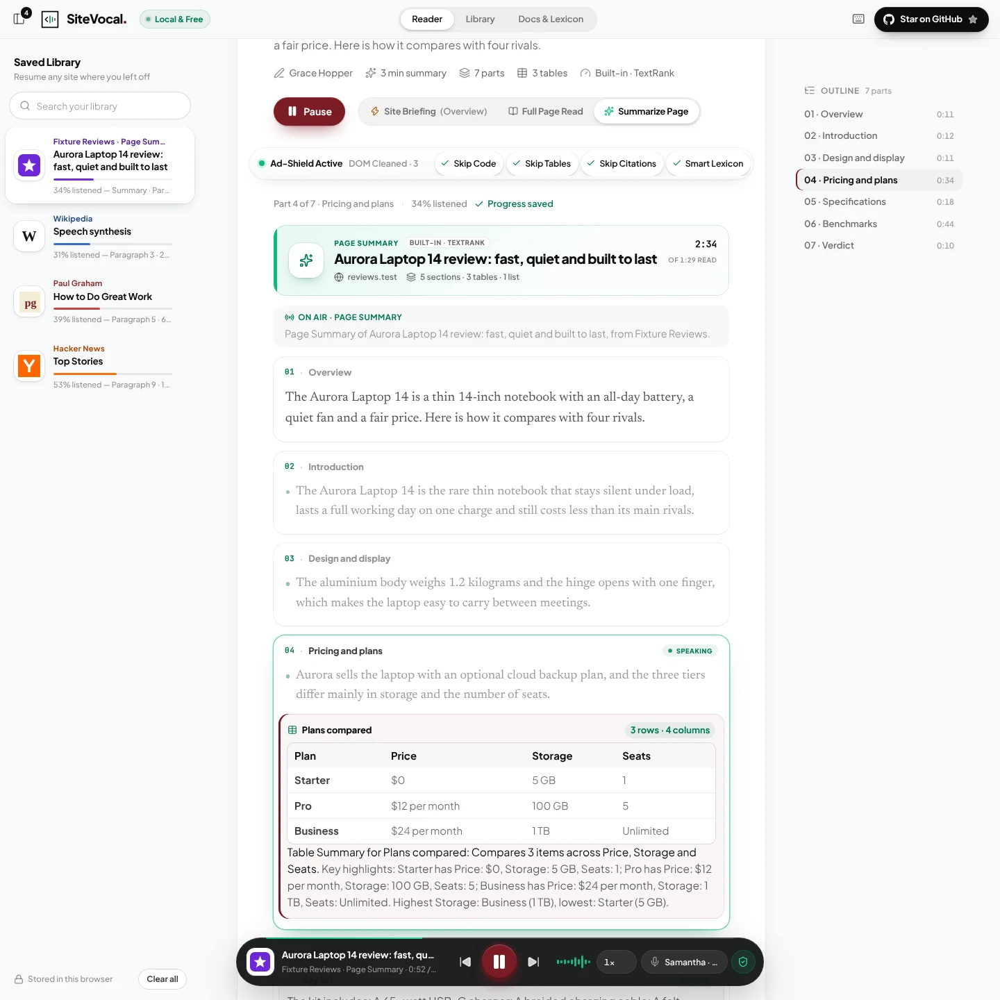

**⚡ Site Briefing — a company homepage as a 4-part dossier: logo, name, domain and brand colour, the card being spoken glowing in the site's colour, and the mode switch beside Pause**


**Reader — an ad-heavy page after the Ad-Shield: the website identity header, filter bar, Section Outline rail and floating dock**

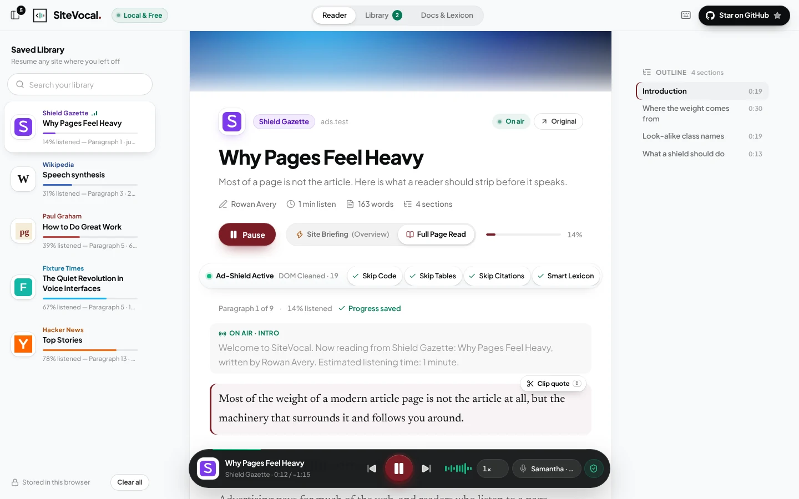

**Library — saved sites, Up Next and a clipped quote**

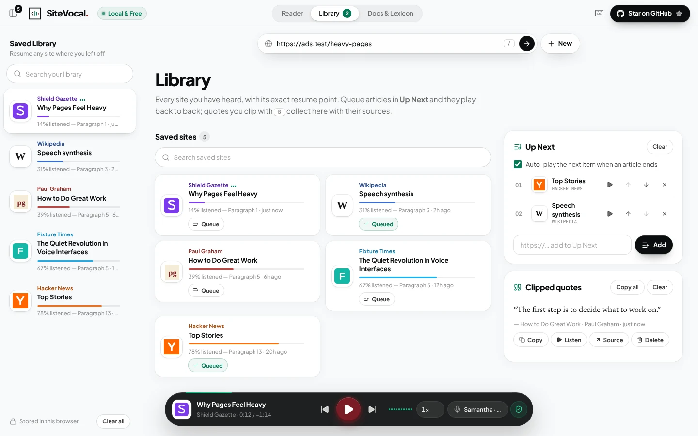

**Docs & Lexicon — the pronunciation dictionary editor with a live preview**

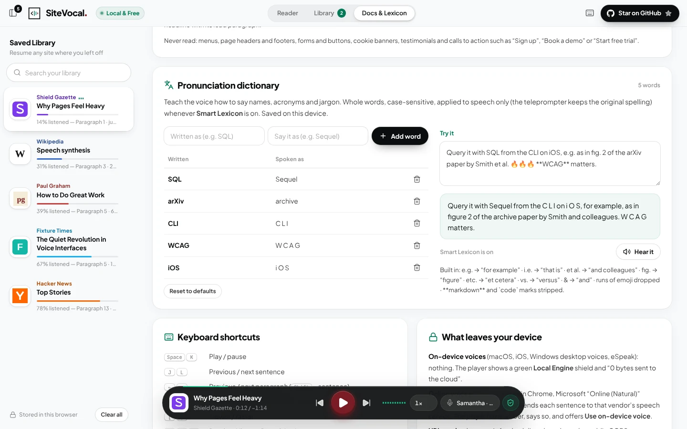

**Chrome extension side panel — reading the active tab, briefing a company homepage, and summarizing a review with its pricing table**

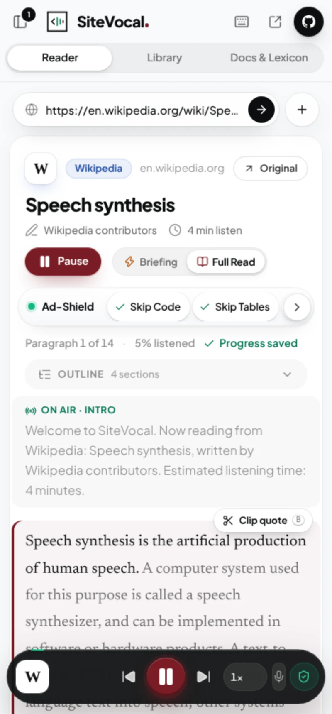 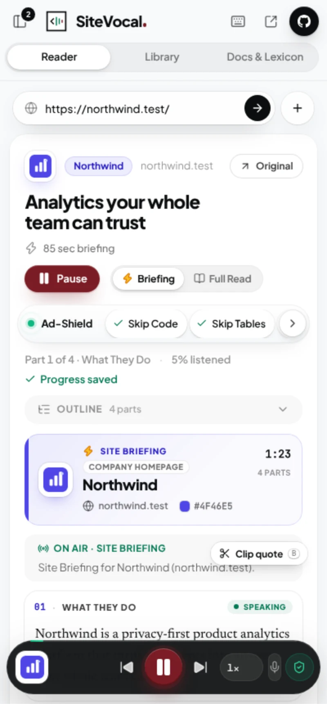 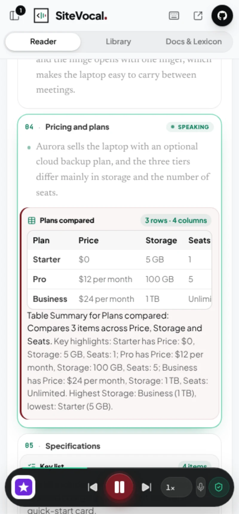

**Start page — one command bar, Quick Try demos and the sound-ripple field**

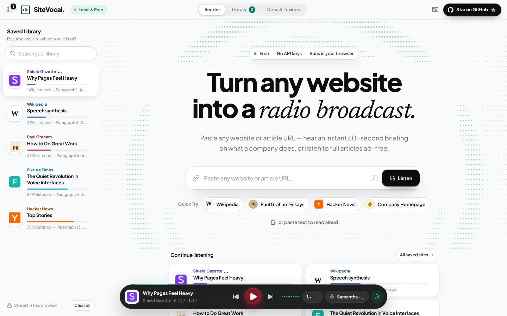

**Start page — "What users reported": six common complaints about free read-aloud tools, the raw text other readers speak, and the line SiteVocal speaks instead**

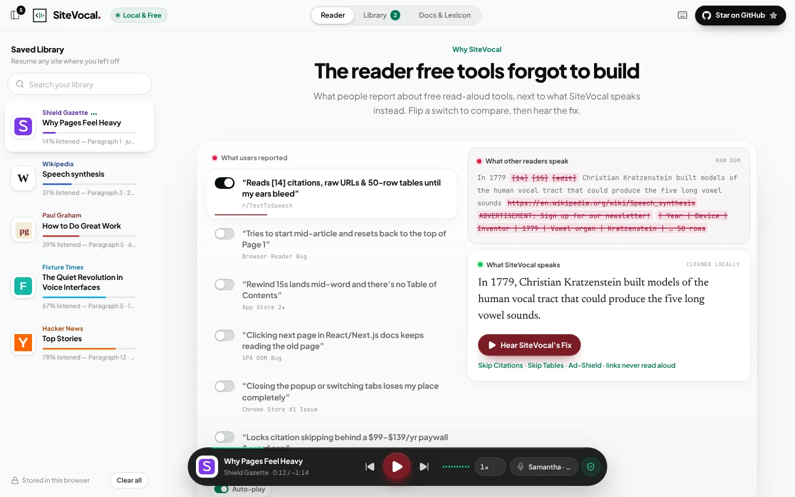

## How SiteVocal works

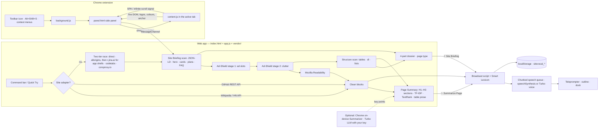

**One codebase, two modes.** `index.html`, `app.js` and `vendor/` load no remote code and no inline script, so the same files run as the web app and as an [MV3 sandboxed page](https://developer.chrome.com/docs/extensions/reference/manifest/sandbox) under the policy `script-src 'self'`. `panel.html` hosts the page in an iframe and hands it a private `MessageChannel` with a short list of capabilities:

- read the tab you clicked SiteVocal on (any tab, once you allow all sites);
- fetch a URL with the extension's own access, when you have allowed it for that site;
- ask Chrome for site access when you press **Allow all sites**, or for one Turbo service;
- persist `sitevocal_*` keys, and clear them all (*Your data › Clear everything*);
- open tabs;
- ask Chrome's on-device Summarizer, which a sandboxed page cannot reach itself;
- post to your Turbo Engine endpoint, only with a key you saved.

Change the app once and both the web app and the extension change.

## Site Briefing mode

Most company homepages are a hero banner, a logo wall, six feature cards, a pricing table, testimonials, an FAQ and four "Get started" buttons. Reading that word for word is useless; Readability (built for articles) often keeps only a fragment of it. Site Briefing reads the **raw** page instead — before the Ad-Shield and Readability strip the "non-article" parts — and turns it into four spoken parts:

| Part | Read from | Spoken as |
|---|---|---|
| **01 · What They Do** | JSON-LD `Organization`, `WebSite`, `SoftwareApplication`, `Product`, `LocalBusiness`; `meta[name=description]`, `og:description`; the hero `<h1>` and its lead paragraph. A definition ("X is a …") beats a slogan, and a call-to-action sentence ("Start your free trial today.") is cut. Founding year, city and rating come from JSON-LD. | *"Site Briefing for Northwind (northwind.test). What they are: Northwind is a privacy-first product analytics platform …"* |
| **02 · What They Provide** | The strongest grid of feature cards (an `h2`/`h3` with its own `<p>` or `<li>` items), then sections or a `<li><strong>Title</strong> …</li>` feature list, then JSON-LD `featureList`; de-duplicated, 3 to 6 items. On a restaurant or shop page the items carry their price. | *"What they provide and key capabilities: First, Event tracking. Capture clicks, page views and custom events … Second, Dashboards. …"* |
| **03 · Pricing & Audience** | Plan cards ("Pro · $12 per user / month" → *"$12 per user per month"*), free plans and trials, open source, "no credit card required", JSON-LD `offers` and `priceRange`, and "Built for …" / "Trusted by …" statements. | *"Pricing and access: A free plan is available, with a 14-day free trial and no credit card required. Plans: Free at $0 per month. Pro at $12 per user per month, billed annually. Enterprise, custom pricing. Who it's for: Built for product teams at fast-growing companies."* |
| **04 · Key Takeaways** | JSON-LD `FAQPage`, `<details>`/`<summary>`, question headings and `<dt>`/`<dd>` pairs; otherwise each remaining section's first sentence. | *"Key takeaways. Common questions: Is there a free plan? Yes. The Free plan includes 1 million events a month …"* |

**Never read:** `nav`, page `header`s that hold only the logo and menu, `footer`, forms and buttons, cookie, consent and announcement banners, testimonials and quotes, logo walls and link farms, hidden elements, and any line that is only a call to action — "Sign up", "Log in", "Book a demo", "Start free trial", "Get started", "Learn more", "Contact sales". Section labels like "Features", "Pricing", "What our customers say" or "Ready to get started?" introduce content but are never an offering.

**A briefing, not a reading.** The script is budgeted to about a minute at 1× (45 seconds for an article overview): when a page has more, the least important lines go first — a third FAQ, a fifth or sixth offering, a second audience line, the headline, the facts. Item titles are spoken as their own short chunk (*"Second, Billing."*), so no utterance gets near Chrome's 15-second limit.

**Which mode opens.** An explicit choice wins (the mode switch, the Company Homepage pill, *Start SiteVocal From Here* — always a full read), then your last choice for that page, then detection: root homepages (`/`, `/en`, `/en-gb`, a GitHub Pages project root), `/pricing` and `/about` pages, and landing pages that score as marketing (company JSON-LD, calls to action, feature cards, plan cards, FAQs, many sections, short scattered paragraphs) open as a briefing; pages with `NewsArticle`/`BlogPosting` JSON-LD, `og:type=article` or long narrative paragraphs open as a full read. A page with almost nothing to brief on stays a full read, and a homepage with nothing to read in full but plenty to brief on opens as a briefing.

**On screen** the teleprompter becomes a dossier sheet: the site's logo, name, domain and a brand-colour swatch, then the four numbered cards. The card being spoken glows in the site's own colour and shows a *Speaking* badge; the spoken line keeps SiteVocal's burgundy rule. The Section Outline lists the parts with their timings, and the library card, dock and status line say *Site Briefing · Part 2 of 4*.

## Summarize Page mode

A Site Briefing answers "what is this?" and a Full Page Read gives you every word. **✨ Summarize Page** sits in between: the whole page, in a few minutes, with nothing important skipped and nothing extra added.

1. **Clean first.** The 3-stage Ad-Shield runs before anything is summarized, so ad slots, sponsored boxes, "Read more" plugs, newsletter sign-ups and promotional "Add to cart" boxes never reach the summary.
2. **Map the page.** The cleaned page is split at its `H1` and every `H2`/`H3`. Tables, pricing and comparison grids, `<dl>` definition lists and `<ul>`/`<ol>` lists are found in the same pass and kept with their section, even when Readability would have dropped them.
3. **Score every sentence.** Each sentence is scored by:
   - its position in its section;
   - its TF-IDF and TextRank keyword centrality (the words and sentences the rest of the page keeps returning to);
   - its density of numbers and names.

   Near-duplicates are dropped, and so are captions, datelines, bylines and reader call-outs ("Share your photos…"). A sentence that leans on the one before it ("This…", "But…") scores lower, and a leading "But" or "However" is dropped.
4. **Pick a few points (2.7).** One line says what the page is (its description, or its strongest opening sentence). Then two to five points are picked from anywhere on the page, more for a longer page: each must be a plain sentence (mostly words, not code, versions or acronyms), say something new, and not refer to the layout. The opening weighs a little more, and no section gets more than its share. They are read in page order, with no headings: usually under a minute.
5. **One table line.** The pricing table, else the largest table of numbers, becomes one sentence with its highest and lowest values. Other tables, spec lists and bullet lists stay in Full Page Read. Promotional boxes, layout tables and calendars are left out.

| On the page | Spoken as |
|---|---|
| A comparison or pricing `<table>` | *"Table Summary for Plans compared: Compares 3 items across Price, Storage and Seats. Key highlights: Starter has Price: $0, Storage: 5 GB, Seats: 1; Pro has Price: $12 per month, Storage: 100 GB, Seats: 5; … Highest Storage: Business (1 TB), lowest: Starter (5 GB)."* Numbers are compared with their units, so 1 TB beats 100 GB. |
| A `<dl>` spec list or a two-column key–value table | *"Key details: Weight: 1.2 kg; Battery: Up to 18 hours; Display: 14-inch, 500 nits; …"* |
| A `<ul>` list | *"The kit includes: A 65-watt USB-C charger; A braided charging cable; A felt sleeve; A quick-start card."* |
| An `<ol>` list | *"In 4 steps: first, …"* |

**Tables are never skipped here.** In Summarize Page and Site Briefing, tables are summarized even with **Skip Tables** on; that chip still applies to the Full Page Read.

**Optional writers.** When Chrome's built-in **Summarizer** (Gemini Nano, on your device) is already downloaded, it writes each section's key points, and SiteVocal still writes the table summaries itself. With a **Turbo Engine** LLM key, your own OpenAI-compatible model writes them instead. If either is missing, fails or takes longer than 30 seconds, the built-in summary plays at once. The summary header says which engine wrote it: *Built-in · TextRank*, *Chrome on-device AI* or *Turbo · model*.

**On screen.** The teleprompter becomes a summary sheet: a *Page Summary* header with the summary's length, the full read's length and what it covers (*5 sections · 3 tables · 1 list*), then one card per section. Every table, grid or list appears as a **Summarized Table Card**: its title, its size, a preview of its header row and first rows, and the sentence being spoken. The Section Outline lists the cards with their timings.

**When it opens.** Summarize Page never opens by itself. It plays when you click **✨ Summarize Page**, and the library remembers the choice for that page. Each mode keeps its own place: switch to the Full Page Read and back, and you return to the same card.

## The 3-stage Ad-Shield

The shield runs on the parsed page **before** Mozilla Readability sees it:

1. **Stage 1 — ad slots.** Removes `[data-ad]`, `[data-ad-unit]`, `[aria-label*="advertisement" i]`, `[aria-label*="sponsored" i]`, `.ad-slot`, `.ad-container`, `.outbrain`, `.taboola`, `.newsletter-signup`, `.inline-related`, `.affiliate-disclaimer` (plus `ins.adsbygoogle` and Google ad iframes), and any element whose class or id contains an ad word as a whole token:

   ```text
   (^|[-_\s])(ad|ads|advert|sponsor|promo)([-_\s]|$)
   ```

   `ad-slot`, `top_ads` and `promo-box` match; `header`, `read`, `load`, `shadow`, `badge` and `download` never do.
2. **Stage 2 — clutter.** Short "Read more:" / "Related:" link boxes, affiliate disclaimers ("we may earn a commission…") and newsletter sign-ups.
3. **Stage 3 — telemetry.** Every node removed is counted: the filter bar shows *Ad-Shield Active · DOM Cleaned · X* for the page, and the privacy panel keeps a lifetime *X ads stripped* total.

A node is only removed when it is small or mostly links — never an `<article>`, `<main>`, the `<h1>` or a block of real prose. WordPress-style article classes such as `category-ads` are therefore safe, and a sentence like "Add the eggs and whisk." is never mistaken for an ad.

## Filter chips and the Smart Lexicon

The liquid-glass filter bar under the identity header has four rounded chips. Changing one rebuilds the broadcast script on the spot, on the same paragraph and sentence:

| Chip | On (default) | Off |
|---|---|---|
| **Skip Code** | Code blocks are shown and announced as skipped | Code is read line by line |
| **Skip Tables** | Data tables are drawn on screen and skipped in audio (Summarize Page and Site Briefing summarize them anyway) | Rows are read as sentences ("Row 1: Year 1961, System IBM 704.") |
| **Skip Citations** | `[12]`, `[a]`, `[citation needed]` are hidden and silent | Markers are shown and announced ("citation 12") |
| **Smart Lexicon** | Abbreviations, dictionary, emoji and markdown clean-up | The voice reads the text exactly as written |

The **pronunciation dictionary** lives in the *Docs & Lexicon* tab and in `localStorage` under `sitevocal_lexicon`. Entries are whole-word and case-sensitive, applied to speech only (the teleprompter keeps the original spelling). It ships with `SQL` → "Sequel", `arXiv` → "archive", `CLI` → "C L I", `WCAG` → "W C A G" and `iOS` → "i O S", and a *Try it* box shows exactly what the voice will say.

## The Chrome 15-second speech cut-off — and how SiteVocal fixes it

Chrome's network voices silently stop an utterance after roughly 15 seconds, so long articles "just stop". Naive fixes (one giant utterance, or the `pause()`/`resume()` keep-alive hack) are fragile and often cause overlapping voices. SiteVocal's engine:

1. **Chunks by sentence** with `Intl.Segmenter`, merging tiny sentences and splitting long ones at clause boundaries — each utterance is about 150 characters (≈ 10 seconds at 1×), well under the cut-off. Citation markers are never split in half.
2. **Keeps exactly one utterance in flight.** The next chunk is spoken from the previous one's `onend`, never pre-queued.
3. **Uses a cancellation token.** Play, pause, jump, seek, speed, voice and filter changes bump the token, call `speechSynthesis.cancel()`, detach the old handlers and wait 80 ms before speaking — stale `onend`/`onerror` events can never advance or double the queue.
4. **Holds a strong reference** to the live utterance (Chrome drops `onend` for garbage-collected utterances) and runs a **watchdog** that retries a stalled sentence instead of hanging.
5. **Resumes mid-sentence** from the last word boundary on voices that report them, and **estimates word timing** (self-calibrating characters-per-second) on voices that don't, so the word highlight works everywhere.
6. **Recovers automatically:** network-voice failures retry, then fall back to a local voice; another app interrupting speech pauses cleanly; the autoplay policy (`not-allowed`) shows a one-tap *Tap to start listening* prompt.

## Smart Broadcast Script Synthesizer

A deterministic pipeline (no LLM, no API) turns raw DOM into a script:

- **Intro:** *"Welcome to SiteVocal. Now reading from [Website Name]: [Article Title], written by [Author]. Estimated listening time: [X] minutes."* (The author clause is omitted when the author is the site, e.g. Paul Graham. After a title that already ends in “!” or “?”, it starts a new sentence: “…champion! Written by…”.)
- **Sections:** `<h2>`/`<h3>` are announced naturally (*"Next section: History."*) with a short pause before and after — and listed in the Section Outline.
- **Code and tables:** stay on screen and are announced as skipped, or read aloud when you turn the chip off.
- **Quotes:** *"Quote: … End quote."*
- **Radio-friendly speech:** the Smart Lexicon, `&` → "and", `1990–1995` → "1990 to 1995" — while the teleprompter keeps the original text.
- **Sign-off:** *"That concludes this article from [Website Name], brought to you by SiteVocal."*
- **Page Summary script:** *"Page Summary of [Title], from [Website Name]."* → the overview → each section's key points, tables and lists → *"That concludes this Page Summary of [Website Name], from SiteVocal. For every word, choose Full Page Read."* See [Summarize Page mode](#summarize-page-mode).
- **Site Briefing script:** *"Site Briefing for [Site Name] ([domain])."* → *"What they are: …"* → *"What they provide and key capabilities: First, … Second, …"* → *"Pricing and access: …"* → *"Key takeaways. Common questions: …"* → *"That concludes this Site Briefing on [Site Name], from SiteVocal. For every word, choose Full Page Read."* See [Site Briefing mode](#site-briefing-mode).

## Design system

SiteVocal uses a strict 75 / 15 / 7 / 3 palette:

| Share | Role | Tokens |
|---|---|---|
| 75% | Surface: the `#F8F9FA` canvas and white `#FFFFFF` reading sheets with a soft `0 4px 24px rgba(0,0,0,.04)` elevation. Translucent liquid glass (`backdrop-filter: blur(20–24px) saturate(180%)`) is kept for floating chrome: the header, address pill, filter bar and toasts | `--sv-paper`, `--sv-sheet` |
| 15% | Obsidian `#0B0D0E`: type, the floating audio dock (`rgba(11,13,14,.92)`, `blur(24px)`, a `1px rgba(255,255,255,.14)` specular top edge), code blocks and the Star on GitHub pill | `--sv-ink` |
| 7% | Emerald: `#047857` on light (live status dots, "on" chips, the Local & Free badge), `#10B981` on dark (the waveform and progress rim) | `--sv-green-ink`, `--sv-emerald` |
| 3% | Burgundy `#7A1C24` (hover `#5E141B`): only the Play trigger, the spoken paragraph's rule and the logo's final bar | `--sv-burgundy` |

The website's own brand colour (the "Chameleon" accent) is used only where that website is shown — its site-name pill, logo glow, library card and the Site Briefing dossier (its accent rule, swatch and the glow of the card being spoken) — never for SiteVocal's own chrome. It comes from the page's `theme-color`, a known brand, colours painted on the page (never the browser's default link blue, and never a colour seen only once) or the site's logo; a page with none of these gets SiteVocal emerald.

**Type.** Plus Jakarta Sans for the interface, Newsreader at 20 px / 1.75 in a 66ch column for reading, JetBrains Mono only for code and the hero's letter field.

**Logo.** **The Speaking Tag** is drawn only with straight lines on a 24 × 24 grid: a 1.5-unit square frame holding slightly thinner 1.25-unit inner lines — a 45° code chevron and three sound bars that step down 9 → 6 → 3, two in emerald and the last in burgundy. The 16 px icon uses a pixel-snapped version so it stays sharp.

**Wordmark.** Mixed-case **SiteVocal** set in Plus Jakarta Sans ExtraBold (800) at 1.15 rem with −0.035em tracking, “Site” and “Vocal” both in obsidian `#0B0D0E`, closed by a small burgundy `#7A1C24` full stop that repeats the logo's point. It is live text, so it stays crisp at every size and screen readers hear “SiteVocal”.

**Motion.** Short and physical: a spring-loaded thumb slides under the selected tab, panels and the reading sheet rise in, and the dock springs up from the bottom. The hero's sound-ripple field — rows of faint dots that resolve into emerald letters as each ripple passes — runs at about 30 fps only while it is on screen. Everything honours `prefers-reduced-motion`.

## Saved Library, Up Next and clipped quotes

| Key | Contents |
|---|---|
| `sitevocal_library` | Saved websites: logo candidates, site name, title, author, brand colour, language, counts, current paragraph/sentence, percent listened, finished flag, timestamps, the listening mode (Site Briefing, Full Page Read or Page Summary) and the other modes' places |
| `sitevocal_doc_<id>` | The cleaned article, its Site Briefing dossier, its tables and lists, and any on-device or Turbo key points for each entry, so a card restores its text, theme and position instantly — even offline (oldest documents are evicted automatically past ~2.4 M characters) |
| `sitevocal_queue` | The Up Next queue (library entries or URLs) |
| `sitevocal_clips` | Clipped quotes with title, site, URL and position |
| `sitevocal_lexicon` | Your pronunciation dictionary |
| `sitevocal_stats` | Lifetime telemetry: words spoken, ads and clutter stripped |
| `sitevocal_settings` | Voice, speed, sidebar, outline, auto-play and the four filter chips |
| `sitevocal_turbo` | The optional Turbo Engine: which voice and summarizer, endpoints, models and your keys (on this device only; **Clear keys** removes them) |

Progress is saved continuously while you listen and immediately on pause, click-to-jump, seek, tab hide and page close. Other tabs and extension surfaces merge their changes instead of overwriting yours. In the extension the same keys are stored in the extension's own `localStorage` and shared by the side panel, popup and full-tab studio.

**Your data** (start page, Library footer or privacy panel) lists all of these keys in plain words and clears them with **Clear everything**. With *Forget what I listened to when I close SiteVocal* on, the library, saved pages, clips, Up Next and statistics are erased whenever SiteVocal closes; settings, the dictionary and Turbo keys stay.

## Voice selection

Voices are ranked by language match first (exact locale, then base language), then quality cues in the name — `Natural`, `Neural`, `Premium`, `Online`, `Siri`, `Enhanced`, `Google` — with novelty voices (Albert, Bad News, Zarvox…) pushed to the bottom. Typical winners: *Microsoft Aria Online (Natural)* in Edge, *Google US English* in Chrome, *Samantha*/*Ava (Premium)* in Safari. The voice menu marks each voice **on-device** or **online**. The intro and sign-off use an English "announcer" voice when an article is in another language.

## Optional Turbo Engine

SiteVocal never needs a key. If you want a cloud neural voice or an LLM-written summary, open *Docs & Lexicon › Turbo Engine (Optional Fish Audio / Custom TTS & Summarizer API)*:

| Setting | Options |
|---|---|
| Neural voice | **Local voices** (default, free) · **Fish Audio**: your API key, an optional voice model ID (`reference_id`) and the model (`s2-pro` by default), sent to `https://api.fish.audio/v1/tts` · **OpenAI-compatible**: any `/v1/audio/speech` endpoint, key, model (`gpt-4o-mini-tts` by default) and voice (`alloy`). A local server works too. |
| Summarizer | **Built-in** (TextRank, offline, default) · **OpenAI-compatible LLM**: any `/v1/chat/completions` endpoint, key and model (`gpt-4o-mini` by default) |
| Chrome's on-device AI | Use Chrome's built-in Summarizer when it is already downloaded (on by default). In a Chrome tab, one click downloads the model. |
| Page reader | **Keyless race** (default, free) · **Jina Reader key**: sent to `r.jina.ai` with the page address, in place of the keyless request · **TinyFish key**: TinyFish Fetch (`api.fetch.tinyfish.ai`) renders the page in place of the keyless reader, which steps in only if TinyFish fails. TinyFish works best in the extension. |

- **The gate.** Every Turbo request is checked first: it must go to the endpoint you saved, with a key. With no key, nothing is sent, and the accordion and the privacy panel say *0 Bytes Sent to Cloud*.
- **What is sent.** Only the sentence being spoken (voice), the page's title, site name and section text (summary), or the page's address (page reader), without cookies or referrer. The privacy panel names the service and counts the bytes.
- **Fallback.** A rejected key, a network error or a timeout switches back to the local voice or the built-in summary at once, with a notice.
- **Where it works.** Some services (Fish Audio among them) do not accept requests straight from a web page (CORS). The Chrome extension sends them from its own page once you let it reach that one service: **Test voice** asks Chrome, and so does **Allow** in the notice when a call is blocked. OpenAI-compatible endpoints that allow CORS work in both without asking.
- **Encrypted only.** Endpoints must be `https://`; plain `http://` is accepted only for a server on your own computer or network (a local Kokoro or Piper server, for example).
- **Clear keys** forgets every key and returns to zero.

## Keyboard shortcuts

| Keys | Action |
|---|---|
| `Space` / `K` | Play / pause |
| `J` / `L` | Previous / next sentence |
| `←` / `→` | Previous / next paragraph (`Shift` = sentence) |
| `B` | Clip the spoken sentence with its source |
| `[` / `]` | Slower / faster |
| `1` / `2` / `3` | Reader · Library · Docs & Lexicon |
| `S` | Toggle the Saved Library sidebar |
| `F` | Follow the current paragraph |
| `/` | Focus the command bar (start page) or the address pill |
| `?` / `Esc` | Shortcuts / close panels |
| `Alt` + `Shift` + `S` | (Extension) read the current tab |

`K` keeps its YouTube-style play/pause role, so previous/next sentence live on `J` and `L`. Media keys, headset buttons and the lock screen work too.

## Privacy and security

- **SiteVocal collects nothing.** No backend, no analytics, no accounts. Your library, queue, clips and dictionary never leave your device, and **Your data** shows them and clears them.
- **No site access at install (extension).** SiteVocal reads only the tab you click it on until you press **Allow all sites**; Chrome asks you first, and *Site access · Remove* in the privacy panel takes it back.
- **Voices, honestly.** On-device voices (macOS, iOS, Windows desktop voices, eSpeak) send nothing anywhere, and the dock's privacy shield reads *Local Engine · 0 bytes sent to the cloud*. Some of the most natural voices — Google voices in Chrome, Microsoft "Online (Natural)" voices in Edge — are run by the browser vendor in the cloud: the browser sends each sentence to that service. The shield then turns amber with *Cloud voice · text sent to &lt;vendor&gt;* and a one-click **Use on-device voice**.
- **Summaries stay on your device.** The built-in summarizer and Chrome's on-device Summarizer both run locally. SiteVocal never starts the on-device model's download by itself.
- **The optional Turbo Engine is off until you paste a key.** Then only the endpoint you saved receives the text, without cookies, and the privacy panel names it and counts the bytes. See [Optional Turbo Engine](#optional-turbo-engine).
- **What else goes over the network:**
  - the address of the article you ask for, as soon as you paste it (or rest the pointer on a Quick Try, Up Next or Library item), so it is ready when you press Listen. In URL mode it goes to the site itself and to the `api.allorigins.win` proxy. The `r.jina.ai` reader is asked only for a page that builds itself with JavaScript, or when nothing else answers within 220 ms; codetabs and corsproxy.io follow if those fail. The first full answer is used and the rest are cancelled. Wikipedia, Hacker News and GitHub links go to their official APIs (past GitHub's limit, to `raw.githubusercontent.com` or the page itself);
  - favicons and images from the site;
  - Google Fonts (a stylesheet, never the page you read).

  The extension reads open tabs locally. With all sites allowed, that includes a tab that already shows an address you paste, and pasted links are fetched with the extension's own permissions before any proxy is tried; without that access they load as in the web app, after you agree once in the loading card.
- **No remote code:** every script is a local file (`app.js`, `vendor/readability.min.js`), and there is no inline script, `eval` or `new Function`. The vendored files are pinned, listed with their SHA-384 hashes in [`vendor/README.md`](vendor/README.md), and can be rebuilt byte for byte from their upstream packages.
- **Untrusted page content is never injected as HTML.** Pages are parsed in an inert `DOMParser` document and only their text is rendered, escaped.
- **No cookie-bearing requests chosen by the page you read.** Logos fetched for colour sampling are requested without cookies and never from your local network; only pages *you* ask SiteVocal to open are fetched with your browser session (so subscriber pages work).
- **Extension isolation:** the studio runs in an MV3 sandbox with no extension API access; it talks to `panel.js` only through a private `MessageChannel`. Both the extension pages and the sandbox run under `script-src 'self'`. `panel.js` refuses a Turbo request unless its URL is the endpoint you saved with a key, and passes on only the `Authorization`, `Content-Type`, `Accept`, `X-API-Key` and `model` headers.

| Extension permission | Why it is needed |
|---|---|
| `activeTab`, `scripting` | Inject `content.js` into the tab you click SiteVocal on (icon, shortcut or right-click item) |
| `optional_host_permissions`: `http://*/*`, `https://*/*` | Nothing at install. **Allow all sites** requests both: read any tab from the side panel, including an open tab that shows an address you paste; fetch pasted URLs and site logos before any public proxy is tried. **Test voice** or **Allow** requests a single Turbo service, such as `https://api.fish.audio/*` |
| `context-hook.js` (registered only with all sites allowed) | Remembers which element you last right-clicked, so **Start SiteVocal From Here** knows where "here" is. It sends nothing and changes nothing on the page. Without it, *Start SiteVocal From Here* starts at the text you select. |
| `sidePanel` | Keep playing in the browser side panel while you browse |
| `contextMenus` | *Read this page · Start SiteVocal From Here · Speak Selection · Read linked page* |
| `storage` | Hand toolbar and menu requests to the side panel (`storage.session`) and remember popup vs. side-panel mode |

The SPA watcher only exists in tabs you have asked SiteVocal to read: `content.js` installs a `MutationObserver` there and tells the side panel when the route, title or content changes — nothing leaves your browser.

Full details: [`PRIVACY.md`](PRIVACY.md).

## Publishing to the Chrome Web Store

The folder is store-ready: Manifest V3, no remote code, `script-src 'self'` everywhere, and every permission in use.

1. Build the upload package from the repository root. It contains only the files the extension runs:

   ```sh
   zip -r -X sitevocal-chrome-store.zip manifest.json background.js content.js context-hook.js panel.html panel.js \
     index.html app.js vendor/readability.min.js vendor/styles.css icons LICENSE THIRD_PARTY_NOTICES.txt
   ```
2. In the [Chrome Web Store Developer Dashboard](https://chrome.google.com/webstore/devconsole), upload it.
3. Paste the texts from [`CHROME_STORE_LISTING.md`](CHROME_STORE_LISTING.md): short and detailed description, single-purpose statement, a justification for each permission, remote-code and data-usage answers, and reviewer notes.
4. Add the five 1280 × 800 screenshots from [`store-assets/`](store-assets/).
5. Use [`PRIVACY.md`](PRIVACY.md) as the privacy policy URL.

## Tested on real-world pages

SiteVocal's test suites use fixtures written for it, so 2.1 was also checked against pages it was never developed on: the archived news and blog pages in the test corpus of [newspaper4k](https://github.com/AndyTheFactory/newspaper4k) (CNN, TIME, WIRED, Fox 13, cleveland.com, Yonhap, Nikkei, China Daily, CNN Arabic, Prachatai, LSM.lv and others), scored against that project's own expected article text.

| 23 article pages with expected text, 8 languages | SiteVocal | Mozilla Readability alone |
|---|---|---|
| Mean F1: read text vs expected text | 96.3 % | 95.4 % |
| Mean precision: how little clutter is read | 94.3 % | 92.4 % |
| Mean recall: how much of the article is read | 98.9 % | 99.3 % |
| Pages scoring at least as well as Readability alone | 21 of 23 | — |

The extractor handled all 30 pages in the corpus without an error, no spoken chunk was longer than 158 characters and no URL was read aloud. A review of every element the Ad-Shield removed found only clutter (ad labels, ad-feedback widgets, "Most popular" lists, newsletter boxes, "Read more" plugs and an affiliate disclaimer) and no article text; on the two pages where Readability alone scores higher, the difference is "Read more" plugs and an affiliate disclaimer that the expected text includes and SiteVocal drops on purpose. The run also found four bugs, all fixed in 2.1:

- Right-to-left articles (Arabic, Hebrew, Persian, Urdu) were laid out left-to-right. Paragraphs in a right-to-left script now read right-to-left with the spoken-paragraph rule on the right, and titles follow their own direction.
- A publisher could win over the journalist ("Condé Nast" on WIRED). `article:author` and JSON-LD people now come first; the site or publisher name is used only when nothing else exists.
- Byline labels in other languages ("Autori:", "Auteur :", "Автор:", "Von …", "Por …") and trailing roles stayed in the name, and three authors were read as "A and B and C" instead of "A, B and C".
- Link-shortener and tracking stubs that only carry a `<meta http-equiv="refresh">` were read as empty pages; SiteVocal now follows them, up to two hops.

Limits: the pages are static snapshots from 2013 to 2023 served locally, so JavaScript-rendered pages, paywalls and live bot checks are not covered, and the score is a bag-of-words overlap (characters for Chinese, Japanese and Thai).

**Site Briefing on the same pages (2.2).** Page-type detection was run on all 30 newspaper4k pages plus the two pages in [trafilatura](https://github.com/adbar/trafilatura)'s test resources. Every news and blog article (27 of 27, plus an Apache server-status page) stays a **Full Page Read** by default, so nobody gets a briefing instead of the story they asked for. The four pages that open as a **Site Briefing** are the ones that should: the CNN, WIRED and Yahoo homepages and Mozilla's Firefox Developer Edition product page (six feature cards read as its offerings). On request, the article overview took 10 to 57 seconds on every page, no spoken chunk was longer than 157 characters and no URL was spoken. The company-page extractor itself is covered by regression fixtures for a SaaS homepage (feature grid, plan cards, JSON-LD FAQ), a section-led homepage, a pricing page, an about page, a restaurant (priced menu, `LocalBusiness` JSON-LD) and a developer tool (a `<li><strong>` feature list, MIT licence): there is no internet access in the build sandbox, so live company sites were not tested.

**Summarize Page on the same pages (2.3).** Summarize Page was run on all 32 pages: the 30 newspaper4k pages and trafilatura's two.

- **Errors and duplicates:** none.
- **Clutter:** no URL, ad label, sign-up line or photo credit was spoken. The only line the check flagged, "Not everyone subscribes to a New Year's resolution", is article text.
- **Chunks and speed:** no chunk was longer than 158 characters, and the slowest page took 64 ms to summarize.
- **Coverage:** every section with a sentence in it was summarized. The only exceptions were headings with nothing under them, and an RSS feed with no sentences at all, which SiteVocal declines to summarize (it stays a Full Page Read).
- **Length:** summaries ran from 19 seconds to 3.3 minutes, for example 2.2 minutes for a 17-minute CNN article and 1.7 minutes for an 11-minute WIRED piece.
- **Tables:** on the Apache server-status page, the worker table (21 rows) and its key became two Table Summaries.

The bundled, minified Readability extracts exactly the same text as the original on all 30 article pages.

## Browser support

| Browser | Web app | Extension |
|---|---|---|
| Google Chrome / Chromium 116+ | ✅ | ✅ side panel |
| Microsoft Edge | ✅ (excellent Natural voices) | ✅ side panel |
| Other Chromium browsers (Brave, Vivaldi, Opera…) | ✅ | ✅ side panel where the browser supports `chrome.sidePanel`, otherwise SiteVocal switches the toolbar icon to a popup automatically |
| Safari 16.4+ (macOS, iOS) | ✅ | — |
| Firefox | ✅ | — |

The web app needs a browser with `window.speechSynthesis` and at least one installed voice. On Linux, install `speech-dispatcher` (or use Chrome's built-in Google voices).

✨ Summarize Page works in every browser above: its built-in summarizer is plain JavaScript. Chrome's on-device Summarizer is an extra, used only when the model is downloaded. That needs Chrome 138 or later on a desktop that meets Chrome's hardware requirements for Gemini Nano.

## Project structure

```text
sitevocal/
├── index.html         The studio page: HTML, SEO/OpenGraph/JSON-LD and SiteVocal's own styles (no inline script)
├── app.js             All of SiteVocal's JavaScript: Ad-Shield, extractor, Site Briefing, Summarize Page,
│                      synthesizer, Smart Lexicon, speech engine, Turbo Engine, UI and embedded Lucide icons
├── vendor/            Mozilla Readability 0.6.0 (minified) and Tailwind CSS 4.3.3 (compiled), with rebuild notes
├── manifest.json      Chrome Extension Manifest V3 (side panel, sandbox, commands, context menus, strict CSP)
├── content.js         Injected into the tab being read: live DOM, logos, colours, anchor, SPA watcher
├── context-hook.js    Remembers the right-clicked element for "Start SiteVocal From Here" (with all sites allowed)
├── background.js      Service worker: toolbar icon, Alt+Shift+S, context menus, popup/side-panel mode
├── panel.html/.js     Extension shell that hosts index.html and bridges tab access, fetch, storage,
│                      Chrome's on-device Summarizer and Turbo Engine requests
├── icons/             The Speaking Tag at 16–512 px
├── og-image.png       1200×630 social preview
├── screenshots/       Images used in this README
├── store-assets/      Chrome Web Store screenshots (1280×800)
├── CHROME_STORE_LISTING.md   Store listing texts, single purpose, permission justifications
├── PRIVACY.md         Privacy policy
├── THIRD_PARTY_NOTICES.txt   Licences of the bundled third-party code
├── llms.txt           Plain-language summary for AI assistants and answer engines
└── LICENSE            Apache License 2.0
```

## Customising SiteVocal

The code lives in `app.js` and the styles in `index.html`. Search `app.js` for these constants:

| Constant | Purpose |
|---|---|
| `AD_SELECTOR`, `AD_TOKEN` | Stage 1 of the Ad-Shield |
| `RELATED_LEAD`, `AFFILIATE`, `NEWSLETTER` | Stage 2 clutter patterns |
| `LEXICON_SEED` | The default pronunciation dictionary |
| `PROXIES`, `fetchRoutes`, `READER_AT` | The CORS proxies, when each route of the pasted-URL race starts (in ms), and when the page reader joins (220) |
| `PREFETCH_IDLE`, `PREFETCH_HOVER`, `PREFETCH_TTL`, `PREFETCH_MAX` | Predictive prefetch: 250 ms of no typing, a 120 ms hover, 5 minutes, 10 pages |
| `RICH_CHARS` | Fewer readable characters than this and a page is an app shell: the race waits for the rendered page |
| `GH_RESERVED` | github.com paths that are not repositories (`settings`, `topics`, `marketplace`…) |
| `DEMOS` | URLs behind the four Quick Try pills (`company` is SiteVocal's own product homepage) |
| `CTA_LINE`, `CTA_INLINE`, `SECTION_LABEL` | Call-to-action lines and section labels a Site Briefing never reads |
| `PRICE_RE`, `PERIOD_RE`, `PLAN_NAME`, `AUDIENCE_RE` | How plans, prices and "Built for …" statements are recognised |
| `PRICING_PATH`, `ABOUT_PATH`, `PRODUCT_PATH` | URL paths that open as a Site Briefing |
| `FIELD_TEXT` | The words that surface in the hero's sound-ripple field |
| `KNOWN` | Site names and brand colours for popular domains |
| `PROMO_TABLE` | Tables that are promotions ("Add to cart", "View price"), never summarized |
| `SUM_CAPTION`, `CAPTION_LEAD`, `READER_PROMPT`, `SUM_DATELINE`, `SUM_BYLINE` | Captions, reader call-outs, datelines and bylines that Summarize Page never reads |
| `UNIT_SCALE` | Units compared in table summaries (MB, GB, TB; seconds, minutes, hours) |
| `TURBO_DEFAULTS` | Default Turbo Engine endpoints, models and voice |
| `CHUNK_MAX` | Target characters per utterance (150 ≈ 10 s) |
| `RATES` | Speeds offered in the speed menu |
| `HEADING_PHRASES` | How section headings are announced |
| `:root` tokens | The 75 / 15 / 7 / 3 palette (`--sv-paper`, `--sv-sheet`, `--sv-ink`, `--sv-emerald`, `--sv-burgundy`…) |

If you add or rename Tailwind classes, rebuild `vendor/styles.css` with the two commands in [`vendor/README.md`](vendor/README.md).

If you host SiteVocal somewhere other than GitHub Pages, replace `https://hotragn.github.io/sitevocal/` in the `<head>` (canonical, OpenGraph, Twitter and JSON-LD URLs).

## Troubleshooting

- **"Couldn't read this page"** — every route failed: the site blocks public proxies and bots, and r.jina.ai could not render it (or its keyless limit of 20 pages a minute was reached). Use the Chrome extension on that tab, or *Paste text instead*. The error card lists every route that was tried, and why each failed.
- **"GitHub API limit reached"** — GitHub allows 60 API requests an hour without signing in. Past that, repository READMEs open from `raw.githubusercontent.com`, and issues, pull requests and discussions are read from the page itself (through allorigins.win or r.jina.ai). The status line says which.
- **A homepage opened word for word, or an article as a briefing** — click **⚡ Site Briefing** or **📖 Full Page Read** beside *Listen*; SiteVocal remembers the choice for that page.
- **The briefing missed something** — it is a one-minute overview by design; **📖 Full Page Read** reads every word, and each mode keeps its own place.
- **"There is not enough text on this page to summarize"** — the page has no sentences to summarize (a feed, a gallery, a sign-in page). Full Page Read or Site Briefing may still have something to read.
- **"Chrome's on-device AI couldn't summarize this page"** — the model is not ready, or it took longer than 30 seconds. SiteVocal's built-in summary plays instead. To skip the model, untick *Use Chrome's on-device AI* in *Docs & Lexicon › Turbo Engine*.
- **"Turbo voice failed"** — check the key, endpoint and model in *Docs & Lexicon › Turbo Engine*. In the web app, some services (Fish Audio among them) refuse direct browser requests (CORS): use the Chrome extension, which sends them itself. Playback continues with your local voice.
- **Something real was skipped** — turn off the relevant chip (**Skip Code**, **Skip Tables**, **Skip Citations**) in the filter bar; the script rebuilds on the same paragraph.
- **A word is mispronounced** — add it in *Docs & Lexicon › Pronunciation dictionary* (for example `nginx` → "engine x").
- **No sound / no voices** — check that your OS has text-to-speech voices installed. Chrome on Linux needs `speech-dispatcher`; Chrome's Google voices need a network connection.
- **"Tap to start listening"** — the browser's autoplay policy requires one click before a page may speak (for example after opening a shared `?url=` link).
- **Extension can't read a tab** — browser pages (`chrome://…`, the Web Store, the new-tab page) and PDFs can't be read by extensions. For local files enable *Allow access to file URLs* on the SiteVocal card in `chrome://extensions`.
- **"SiteVocal can't see this tab yet"** — SiteVocal has no site access until you give it: click the SiteVocal icon while you are on that tab, or press **Allow all sites** once.

## FAQ

**What is SiteVocal?**
SiteVocal is a free, open-source website-to-speech reader. Paste any URL (or click the Chrome extension) and it strips the ads and clutter, extracts the article, and reads it aloud like a radio broadcast using your browser's built-in Web Speech API, with a live teleprompter, a section outline and a resume library. It needs no API keys, accounts or servers.

**What is Site Briefing mode?**
A 60 to 90 second spoken overview of a company or website, instead of every word. Paste a homepage, pricing or about page (or click the extension on one) and SiteVocal reads who they are, what they provide, pricing and audience, and the key questions from their FAQ, straight from the page with no API and no AI service. Menus, buttons, cookie banners and calls to action are never read, and one click on **Full Page Read** switches to the word-for-word broadcast, each mode keeping its own place.

**What does Summarize Page do?**
It reads a short spoken summary of the whole page instead of every word or just the opening. After the 3-stage Ad-Shield removes ads, SiteVocal walks the page from its `H1` through every `H2` and `H3` section and keeps the most informative sentences of each. Sentences are ranked by position, TF-IDF and TextRank keyword centrality, and how many numbers and names they carry. Tables, pricing and comparison grids, spec lists and bullet lists are never skipped. Each becomes a short sentence, such as *"Table Summary for Plans compared: Compares 3 items across Price, Storage and Seats…"*, followed by the key rows, and appears as a Summarized Table Card in the teleprompter.

**Does SiteVocal send my pages to an AI service?**
Not unless you ask it to. By default every summary is written on your device, by SiteVocal's built-in summarizer or by Chrome's on-device Summarizer, and the privacy panel says *0 Bytes Sent to Cloud*. The optional Turbo Engine lets you paste your own Fish Audio key, or an OpenAI-compatible speech or chat endpoint and key. Only then is the page's text sent, and only to the endpoint you saved; the privacy panel names it and counts the bytes. **Clear keys** returns to zero.

**How does SiteVocal decide between a briefing and a full read?**
Root homepages, `/pricing` and `/about` pages and marketing landing pages open as a Site Briefing; articles (news JSON-LD, `og:type=article`, long narrative paragraphs) open as a full read. Your own choice wins: switch once and that page reopens the way you left it.

**Does SiteVocal collect my data?**
No. SiteVocal has no server, no account and no analytics, so nothing you read or save is ever sent to its makers. Everything it keeps stays in your browser; **Your data** lists it and **Clear everything** deletes it. Turn on *Forget what I listened to when I close SiteVocal* and your library is erased every time you close it. (Browsers do not let a page show its own question as you close it, so that choice is a switch you set once.)

**Is SiteVocal really free and private?**
Yes. SiteVocal has no backend and your library is saved in your browser's `localStorage`. With an on-device voice nothing about the article leaves your computer, and the player's privacy panel says "0 bytes sent to the cloud". Some of the most natural voices (Google and Microsoft Online voices) are cloud voices run by your browser vendor: the player's shield turns amber when one is in use and switches to an on-device voice in one click. In URL mode the page HTML is fetched directly or through free public CORS proxies; the Chrome extension reads the open tab locally, and asks for no site access until you press **Allow all sites**.

**How does the Ad-Shield remove ads without deleting the article?**
Before Mozilla Readability runs, stage 1 removes known ad containers and elements whose class or id contains ad, ads, advert, sponsor or promo as a whole word, so header, read, load and shadow never match. Stage 2 removes short Read more and Related link boxes, affiliate disclaimers and newsletter sign-ups. A node is only removed when it is small or mostly links, never when it holds the article. Stage 3 counts everything removed and shows it in the reader's filter bar.

**How is SiteVocal different from a paid text-to-speech API?**
Cloud TTS APIs need an account, an API key and usually a credit card, and they send your text to a server. SiteVocal uses the voices already in your browser and operating system, so it is free and works without sign-up; pick an on-device voice and your reading stays completely private.

**How does the Chrome extension read pages I'm logged into?**
`content.js` runs inside the tab you are already viewing and serialises the rendered page, so anything you can see — including subscriber-only articles — can be read without re-downloading it.

**Can SiteVocal start in the middle of an article?**
Yes. In the web app, click any sentence in the teleprompter. In the extension, right-click a paragraph on the page and choose **Start SiteVocal From Here** — playback starts at that paragraph, without the intro.

**Why do other readers stop after about 15 seconds in Chrome?**
Chrome's network voices silently stop long utterances. SiteVocal speaks ≈10-second sentence chunks one at a time with a cancellation token, so long articles never cut off and changing speed or jumping never causes overlapping voices.

**Which voice does SiteVocal use?**
It ranks `speechSynthesis.getVoices()` and auto-selects the most natural voice for the article's language, prioritising voices labelled Natural, Online, Neural, Premium, Google or Siri. You can switch voice and speed (0.75× to 2×) at any time, and teach it pronunciations in the Docs & Lexicon tab.

**Does SiteVocal read Arabic, Hebrew and other right-to-left languages?**
Yes. Paragraphs written mostly in a right-to-left script are laid out right-to-left and right-aligned, with the spoken-paragraph rule on the right, while SiteVocal's own English intro and any code stay left-to-right. Titles in the identity header, the dock and the library follow their own direction.

**Which websites work?**
Most pages: news, blogs, documentation, Wikipedia, Paul Graham essays, Hacker News, GitHub repositories, files, issues and discussions, and company homepages built with JavaScript (Next.js, React). Wikipedia, Hacker News and GitHub use their official CORS-enabled APIs. Other pages are fetched directly and through public CORS proxies, and the keyless r.jina.ai reader renders the ones that build themselves with JavaScript. Sites that block all of them work through the extension or by pasting the text.

**Does SiteVocal work offline?**
Yes, mostly. Saved articles resume from the library without refetching. Speech works offline with on-device voices, and so do Summarize Page and Site Briefing. Every script is bundled, so the app itself starts offline; only the fonts come from Google Fonts, and system fonts are used without them. Fetching new pages needs a connection.

## Credits and licence

- [Web Speech API](https://developer.mozilla.org/docs/Web/API/SpeechSynthesis) — the speech engine in every modern browser
- [Mozilla Readability](https://github.com/mozilla/readability) (Apache-2.0) — article extraction, bundled as `vendor/readability.min.js` (0.6.0)
- [Tailwind CSS](https://tailwindcss.com) (MIT) — utility CSS, compiled ahead of time into `vendor/styles.css` (4.3.3)
- [Lucide](https://lucide.dev) (ISC) — icons, embedded as inline SVG
- [Plus Jakarta Sans, Newsreader, JetBrains Mono](https://fonts.google.com) (OFL) — via Google Fonts
- Optional engines: Chrome's built-in [Summarizer API](https://developer.chrome.com/docs/ai/summarizer-api) on your device, and [Fish Audio](https://fish.audio) or any OpenAI-compatible API with your own key

Licence texts for the bundled code are in [`THIRD_PARTY_NOTICES.txt`](THIRD_PARTY_NOTICES.txt).

SiteVocal is released under the [Apache License 2.0](LICENSE).

<sub>Keywords: website to speech, text to speech, read aloud, company briefing, what does this company do, website summary audio, ad-free reader, listen to articles, article to audio, free TTS, Web Speech API, speechSynthesis, Chrome extension, side panel reader, Readability, pronunciation dictionary, accessibility, dyslexia support, zero API, no API key, SiteVocal.</sub>
